<p align="center">
  
</p>

<p align="center">
  <a href="https://github.com/chenhg5/cc-connect/actions/workflows/ci.yml">
    
  </a>
  <a href="https://github.com/chenhg5/cc-connect/releases">
    
  </a>
  <a href="https://www.npmjs.com/package/cc-connect">
    
  </a>
  <a href="https://github.com/chenhg5/cc-connect/blob/main/LICENSE">
    
  </a>
  <a href="https://goreportcard.com/report/github.com/chenhg5/cc-connect">
    
  </a>
</p>

<p align="center">
  <a href="https://discord.gg/kHpwgaM4kq">
    
  </a>
  <a href="https://t.me/+odGNDhCjbjdmMmZl">
    
  </a>
</p>

<p align="center">
  <a href="./README.md">English</a> | <a href="./README.zh-CN.md">中文</a> | <a href="./README.ru.md">Русский</a>
</p>

<p align="center">
  <a href="https://trendshift.io/repositories/23266" target="_blank">
    
  </a>
</p>


## ❤️ Спонсоры

> Хотите разместить здесь информацию о себе? Контакты: chg80333@gmail.com | WeChat: mongorz

<details open>
<summary>Спонсоры</summary>

[](https://www.kimi.com/code/?aff=cc-connect)

Благодарим [Kimi](https://www.kimi.com/code/?aff=cc-connect) за поддержку проекта! [Kimi K3](https://www.kimi.com/blog/kimi-k3) — самая мощная модель Moonshot AI и первая в мире открытая модель класса 3T. Благодаря 2.8 триллиона параметров, встроенной поддержке изображений и контекстному окну в 1 миллион токенов K3 показывает передовые результаты в длительных задачах программирования, работе со знаниями и рассуждениях.

С помощью cc-connect можно подключить Kimi CLI, работающий на вашем компьютере, к Feishu/Lark, DingTalk, Telegram, Slack, Discord, WeCom и другим мессенджерам. Где бы вы ни находились, вы можете продолжать работу над локальными проектами через чат: просить Kimi изучать и изменять код, находить причины неполадок, выполнять команды и автоматизировать задачи.

cc-connect уже поддерживает Kimi CLI. Попробуйте **подписку Kimi Code** ([китайский сайт](https://www.kimi.com/code?aff=cc-connect) | [международный сайт](https://www.kimi.ai/code?aff=cc-connect)) или воспользуйтесь **API** на открытой платформе Kimi ([китайский сайт](https://platform.kimi.com?track_id=track-78c5d46574a54286a4ff42f7331272ba&aff=cc-connect) | [международный сайт](https://platform.kimi.ai?track_id=track-dd37b0bea7a64b99b3fe2217b398e20b&aff=cc-connect)).

---

<table>
<tr>
<td width="150"><a href="https://apinebula.com/UrO0q1">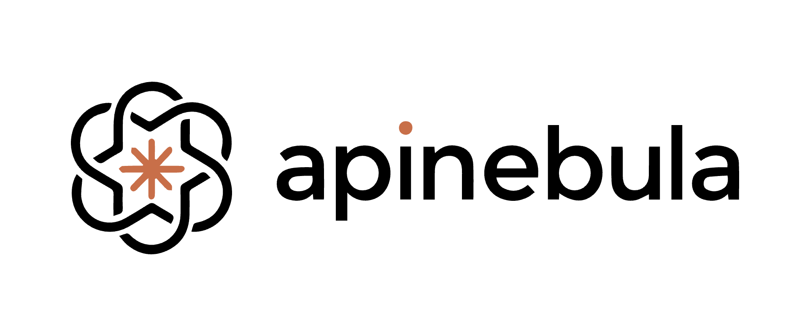</a></td>
<td>Благодарим APINEBULA за поддержку проекта! APINEBULA — корпоративная платформа агрегации ИИ-сервисов компании Galaxy Video Bureau. Опираясь на обширные ресурсы платформы, она предоставляет разработчикам, командам и предприятиям стабильный и экономичный доступ к API больших языковых моделей. Платформа объединяет ведущие модели без урезания возможностей, включая Claude, GPT и Gemini: один API открывает доступ к лучшим ИИ-моделям мира по цене от 10% исходной стоимости. APINEBULA подходит для программирования с ИИ, разработки ИИ-агентов и интеграции бизнес-систем; поддерживает большое число параллельных запросов корпоративного уровня, официальные договоры, расчёты между юридическими лицами и выставление счетов. Для пользователей нашего ПО действует специальное предложение: зарегистрируйтесь по <a href="https://apinebula.com/UrO0q1">этой ссылке</a> и при первом пополнении введите промокод "ccconnect", чтобы получить скидку 10%.</td>
</tr>

<tr>
<td width="150"><a href="https://s.qiniu.com/aUbueu"></a></td>
<td>Благодарим <a href="https://s.qiniu.com/aUbueu">Qiniu Cloud AI</a> за поддержку проекта! Qiniu Cloud (HK:02567) — корпоративная MaaS-платформа больших языковых моделей, которая предоставляет единый доступ к 150+ ведущим мировым моделям и полностью совместима с протоколами всех основных поставщиков. Платформа охватывает все модальности: обработку текста, изображений, аудио, видео и файлов. Ею пользуются более 1.69 миллиона корпоративных клиентов и разработчиков по всему миру. Специальное предложение для пользователей cc-connect: корпоративные клиенты получают 12 миллионов бесплатных токенов, а за приглашение друзей можно получить бонусы вплоть до миллиардов токенов.</td>
</tr>

<tr>
<td width="150"><a href="https://api.fenno.ai/register?redirect=/purchase?tab=subscription%26group=16&aff=C7KG6WBS7CQJ"></a></td>
<td>Благодарим Fenno.ai за поддержку проекта! Fenno.ai — стабильный и эффективный сервис проксирования API, который сейчас предоставляет доступ к Codex с полной совместимостью с протоколами OpenAI и Anthropic. Он легко интегрируется с популярными инструментами программирования, включая Codex, Claude Code и OpenCode, и надёжно обслуживает корпоративные нагрузки в сотни миллиардов токенов в день. Fenno.ai поддерживает расчёты между юридическими лицами в Китае и за рубежом, а также выставление счетов. Специальное предложение для пользователей cc-connect: оформите подписку по <a href="https://api.fenno.ai/register?redirect=/purchase?tab=subscription%26group=16&aff=C7KG6WBS7CQJ">этой ссылке</a>, чтобы получить выгодный Coding Plan за ¥9.9 с кредитом на $150, и получайте бонус до 20% за каждого приглашённого друга.</td>
</tr>

<tr>
<td width="150"><a href="https://aigocode.com/invite/CYY3C85C">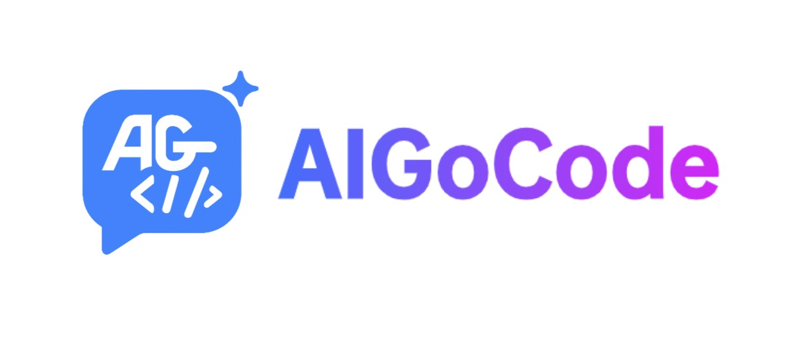</a></td>
<td>Благодарим AIGoCode за поддержку проекта! AIGoCode объединяет Claude Code, Codex и новейшие модели Gemini на одной платформе, предоставляя стабильные, быстрые и выгодные сервисы программирования с ИИ. Платформа предлагает гибкие подписки, отсутствие риска блокировки аккаунта, прямое подключение без VPN и очень быстрые ответы. Для пользователей cc-connect подготовлен специальный бонус: зарегистрируйтесь по <a href="https://aigocode.com/invite/CYY3C85C">этой ссылке</a> и получите дополнительные 10% к сумме первого пополнения!</td>
</tr>

<tr>
<td width="150"><a href="https://go.apimart.ai/gh-cc-connect"></a></td>
<td>Благодарим APIMart за поддержку проекта! APIMart — недорогая API-платформа для генерации изображений и видео с помощью ИИ: GPT-Image-2 от $0.006 за изображение, более 160 изображений за доллар. Единый асинхронный API работает и с изображениями, и с видео: отправьте задачу, получите ID, затем заберите результат опросом или через callback. Обрабатывайте десятки тысяч изображений пакетно без тайм-аутов и меняйте модели без изменения кода. Оплата по мере использования, без ежемесячной платы — <a href="https://go.apimart.ai/gh-cc-connect">зарегистрируйтесь здесь</a>, чтобы начать работу.</td>
</tr>

<tr>
<td width="150"><a href="https://www.dmxapi.cn/register?aff=NDln">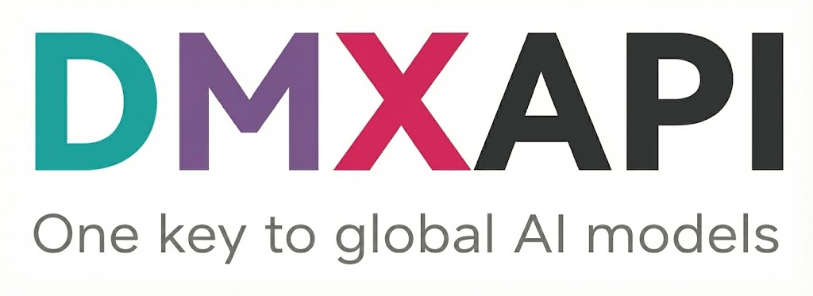</a></td>
<td>Благодарим DMXAPI за поддержку проекта! DMXAPI предоставляет API мировых больших моделей более чем 200 корпоративным пользователям. Один API-ключ для всех мировых моделей. Возможности: мгновенное выставление счетов, неограниченное число параллельных запросов, старт от $0.15, техническая поддержка 24/7. На все GPT/Claude/Gemini действует скидка 32%, на китайские модели — 20–50%, на эксклюзивные модели Claude Code — 66%! Зарегистрируйтесь по <a href="https://www.dmxapi.cn/register?aff=NDln">этой ссылке</a>.</td>
</tr>

<tr>
<td width="150"><a href="https://apikey.fun/register?aff=cc_connect"></a></td>
<td>Благодарим APIKEY.FUN за поддержку проекта! APIKEY.FUN — профессиональный корпоративный сервис проксирования ИИ, предоставляющий предприятиям и независимым разработчикам стабильный, эффективный и недорогой доступ к API ИИ-моделей. Платформа поддерживает Claude, OpenAI, Gemini и другие популярные модели по цене от 7% официальных тарифов. Зарегистрируйтесь по <a href="https://apikey.fun/register?aff=cc_connect">этой ссылке</a>, чтобы получить эксклюзивную постоянную скидку 5% на все пополнения!</td>
</tr>

<tr>
<td width="150"><a href="https://www.shengsuanyun.com/?from=CH_67XCLZGS">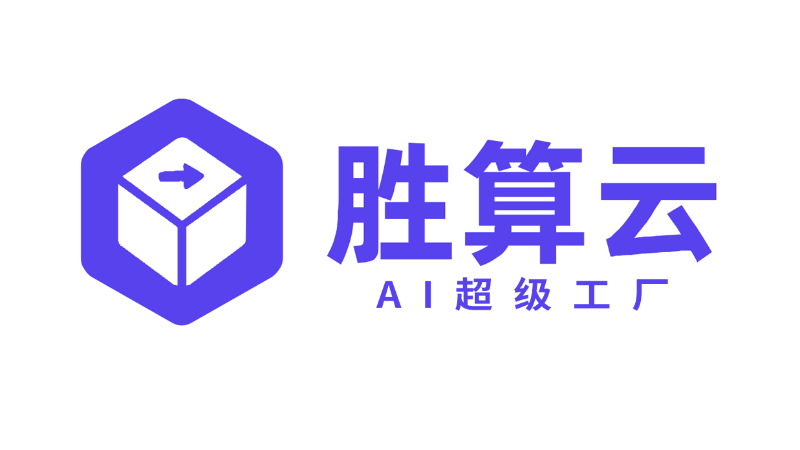</a></td>
<td>Благодарим Shengsuanyun за поддержку проекта! Shengsuanyun — «суперфабрика» для команд, строящих работу вокруг ИИ (AI Native Teams): платформа промышленного уровня для параллельного выполнения ИИ-задач и маркетплейс моделей, который объединяет и напрямую предоставляет вычислительные ресурсы китайских и зарубежных LLM, а также мультимедийных моделей для изображений и видео, включая Claude, Chatgpt и Gemini. Сервис гарантирует отсутствие обратной разработки и манипуляций с данными, заявляет доступность по SLA 99.7% для всей платформы, а его <a href="https://watch.shengsuanyun.com/status/shengsuanyun">интерфейс мониторинга</a> стабильно показывает зелёный статус. Также доступен настраиваемый корпоративный шлюз для детального контроля расходов и доступа: интеллектуальная маршрутизация, защита и хранение собственных ключей предприятия по модели BYOK. Предусмотрена оплата по мере использования и тариф tokens plan (скоро появится), доступно выставление счетов. Новые пользователи, зарегистрировавшиеся по <a href="https://www.shengsuanyun.com/?from=CH_67XCLZGS">этой ссылке</a>, получают 10 юаней на использование моделей и бонус 10% при первом пополнении.</td>
</tr>

<tr>
<td width="150"><a href="https://visioncoder.cn"></a></td>
<td>Благодарим VisionCoder за поддержку проекта. <a href="https://visioncoder.cn">Платформа для разработчиков VisionCoder</a> — надёжный и эффективный сервис проксирования API, предоставляющий доступ к популярным ИИ-моделям, включая Claude Code, Codex и Gemini. Он помогает разработчикам и командам проще интегрировать ИИ-возможности и повышать продуктивность. Кроме того, VisionCoder теперь предлагает розничную продажу <strong>премиальных аккаунтов</strong> <strong>Claude Max 200</strong> и <strong>GPT Pro 200</strong>, чтобы пользователи могли сразу получить доступ к передовым вычислительным ресурсам и функциям ИИ.</td>
</tr>

<tr>
<td width="150"><a href="https://runapi.co/register?aff=4BXa"></a></td>
<td>Благодарим RunAPI за поддержку проекта! RunAPI — эффективная и стабильная API-платформа, альтернатива OpenRouter. Один API-ключ открывает доступ к 150+ ведущим моделям, включая OpenAI, Claude, Gemini, DeepSeek, Grok и другие, по цене от 10% исходной стоимости (скидка до 90%) и с исключительно стабильной работой. Сервис полностью совместим с Claude Code, OpenClaw и другими инструментами. Специальный бонус для пользователей cc-connect: зарегистрируйтесь и свяжитесь с администратором, чтобы получить ¥7 бесплатного кредита.</td>
</tr>

<tr>
<td width="150"><a href="https://camel.kr777.top/register?aff=V2z8">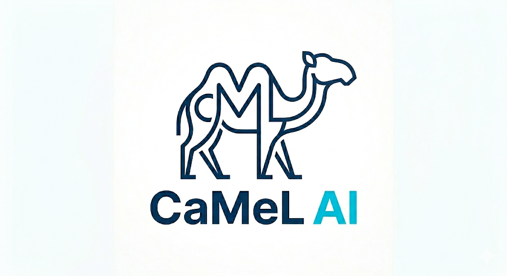</a></td>
<td>Благодарим CaMeL за поддержку проекта! Сервис тесно сотрудничает с крупными исследовательскими институтами и суперкомпьютерными центрами и использует собственное высокостабильное и эффективное решение для планирования работы кеша. Специально для пользователей cc-connect: новые пользователи сразу получают кредит $10 после регистрации и подтверждения личности. Зарегистрируйтесь по <a href="https://camel.kr777.top/register?aff=V2z8">этой ссылке</a>.</td>
</tr>

<tr>
<td width="150"><a href="https://unity2.ai/register?source=ccconnect"></a></td>
<td>Благодарим Unity2.ai за поддержку проекта! Unity2.ai — высокопроизводительная платформа проксирования API ИИ-моделей для независимых разработчиков, команд и предприятий. Она давно обслуживает ведущие китайские предприятия, обрабатывает свыше 30 миллиардов токенов в день и поддерживает нагрузку до 5000 запросов в минуту (RPM). Доступны оплата с баланса, бонус при первом пополнении, комбинированные подписки, выставление счетов предприятиям и индивидуальное сопровождение интеграции. Зарегистрируйтесь по <a href="https://unity2.ai/register?source=ccconnect">этой ссылке</a>, чтобы получить кредит $2, и вступите в официальную группу за дополнительными $10 — всего до $12 бесплатного кредита!</td>
</tr>

<tr>
<td width="150"><a href="https://ergouapi.com/r/gh-cc-connect"></a></td>
<td>Благодарим Ergou API (二狗 API) за поддержку проекта! Ergou API — сервис проксирования API больших языковых моделей с одними из самых низких в отрасли тарифов 0.1x–0.2x для всей платформы и на 100% нативными API Claude, GPT, Gemini и других ведущих LLM. Премиальные линии IPLC и резервирование через двух провайдеров с домашними IP-адресами обеспечивают стабильный доступ с низкой задержкой по всему Китаю. Приглашаем разработчиков и студии <a href="https://ergouapi.com/r/gh-cc-connect">зарегистрироваться</a>.</td>
</tr>

<tr>
<td width="150"><a href="https://cc.anyroute.io/register?aff=CR455DSQSKEV"></a></td>
<td>Благодарим AnyRoute.io за поддержку проекта! AnyRoute.io — надёжная, стабильная и эффективная платформа проксирования API, объединяющая новейшие модели Claude Code и Codex. Прозрачные тарифы со скидкой до 93% от официальных цен (всего 0.7x), выставление счетов и поддержка высокой конкурентной нагрузки корпоративного уровня. Зарегистрируйтесь по <a href="https://cc.anyroute.io/register?aff=CR455DSQSKEV">этой ссылке</a>, чтобы начать работу.</td>
</tr>

<tr>
<td width="150"><a href="https://aicanapi.com/register?aff=rIEy">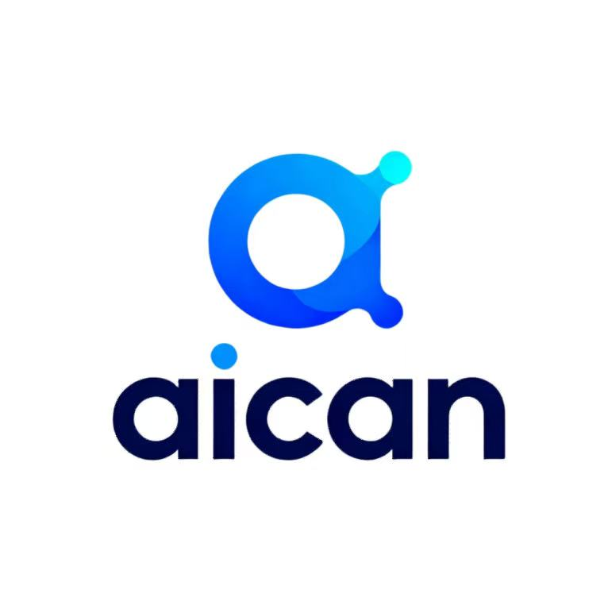</a></td>
<td>Благодарим aicanapi.com за поддержку проекта! Aican API предоставляет предприятиям и разработчикам высокопроизводительные API с низкой задержкой и поддержкой большого числа параллельных запросов. Скидки на модели Claude Code достигают 84%, на другие модели — 80% от официальной цены. Сервис генерации с реальными людьми Doubao Seedance 2 доступен без очереди для более быстрого получения результатов. Aican API делает корпоративные ИИ-сервисы проще, эффективнее и выгоднее. Зарегистрируйтесь по <a href="https://aicanapi.com/register?aff=rIEy">этой ссылке</a>, чтобы начать работу.</td>
</tr>

<tr>
<td width="150"><a href="https://pateway.ai/?ch=2qn568&aff=DRA4VUFS">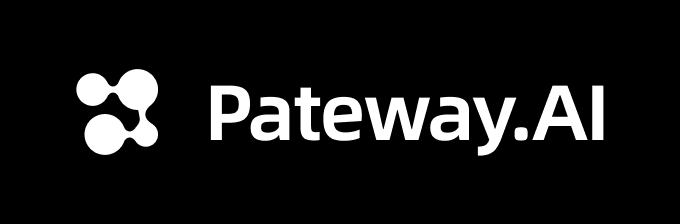</a></td>
<td>Благодарим Pateway за поддержку проекта! PatewayAI — премиальный сервис проксирования API для разработчиков, активно работающих с ИИ. Он предоставляет на 100% официальный прямой доступ к моделям Claude и Codex — без обратной разработки и снижения качества. Прозрачный биллинг с проверкой на уровне токенов. Доступны параллельная обработка запросов корпоративного уровня, официальные договоры и выставление счетов. Зарегистрируйтесь по <a href="https://pateway.ai/?ch=2qn568&aff=DRA4VUFS">этой ссылке</a>, чтобы получить $3 пробного кредита, скидку до 40% на пополнения и вознаграждения за приглашения до $150!</td>
</tr>

<tr>
<td width="150"><a href="https://cy.10dianai.com/register?aff=3FQn"></a></td>
<td>Благодарим 10点AI за поддержку проекта! 10dian-AI Enterprise Platform — шлюз API ИИ для разработчиков и предприятий, объединяющий GPT, Claude, Gemini, DeepSeek и другие модели. Платформа оптимизирована для production: стабильная работа при большом числе параллельных запросов, без нестабильности интерфейсов и тайм-аутов. Доступные цены, стабильная доступность и гарантия использования официальных моделей. Зарегистрируйтесь по <a href="https://cy.10dianai.com/register?aff=3FQn">этой ссылке</a>, чтобы получить ¥5 бесплатного кредита!</td>
</tr>

<tr>
<td width="150"><a href="https://cloud.siliconflow.cn/i/650Yh2Z7">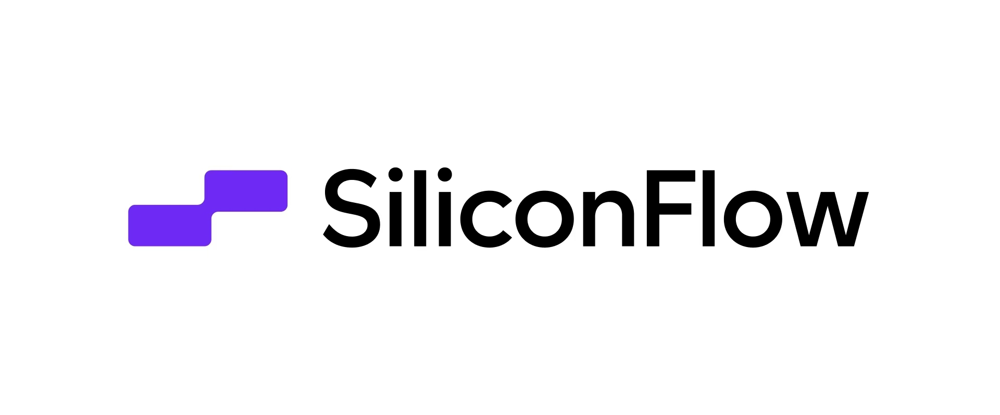</a></td>
<td>Благодарим SiliconFlow за поддержку проекта! SiliconFlow — высокопроизводительная платформа ИИ-инфраструктуры и API моделей, предоставляющая быстрый и надёжный доступ к языковым, речевым моделям, моделям изображений и видео в одном месте. Оплата по мере использования, широкий выбор мультимодальных моделей, быстрый инференс и стабильность корпоративного уровня помогают разработчикам и командам эффективнее создавать и масштабировать ИИ-приложения. Зарегистрируйтесь по <a href="https://cloud.siliconflow.cn/i/650Yh2Z7">этой ссылке</a> и пройдите подтверждение личности, чтобы получить ¥20 бонусного кредита!</td>
</tr>


<tr>
<td width="150"><a href="https://passport.compshare.cn/register?referral_code=H65IOClRGu5CM7nn5ykfad&ytag=GPU_YY_YX_git_cc-connect">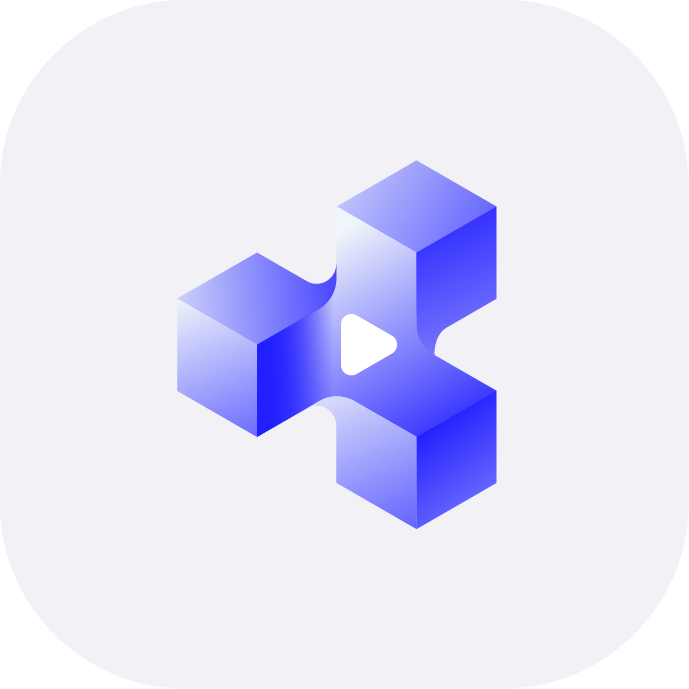</a></td>
<td>Благодарим 优云智算 за поддержку проекта! 优云智算 (UCloud AI Cloud Platform) предоставляет стабильный доступ к широкому набору API китайских и зарубежных моделей по одному ключу. Предлагает выгодные пакеты Coding Plan с помесячной оплатой или оплатой за использование, а также стабильный доступ к зарубежным моделям через официальные каналы. Поддерживает Claude Code, Codex и вызовы API. Корпоративные возможности включают большое число параллельных запросов, техническую поддержку 7x24 и самостоятельное оформление счетов. Зарегистрируйтесь по <a href="https://passport.compshare.cn/register?referral_code=H65IOClRGu5CM7nn5ykfad&ytag=GPU_YY_YX_git_cc-connect">этой ссылке</a>, чтобы получить ¥5 бесплатного кредита на платформе!</td>
</tr>

<tr>
<td width="150"><a href="https://dragoncode.codes/register?ref=23ZELCPX"></a></td>
<td>Благодарим DragonCode за поддержку проекта. DragonCode подготовил специальное предложение для пользователей cc-connect: зарегистрируйтесь по <a href="https://dragoncode.codes/register?ref=23ZELCPX">этой ссылке</a>, чтобы начать работу.</td>
</tr>


<tr>
<td width="150"><a href="https://code0.ai/register?aff=5cGO"></a></td>
<td>Благодарим Code0 за поддержку проекта! Code0 — сервис агрегации и проксирования API ИИ-моделей для китайских разработчиков, совместимый с протоколами OpenAI / Anthropic / Gemini. Один ключ открывает доступ ко всем популярным моделям; обеспечена стабильная поддержка Claude Code, Codex, Gemini CLI, cc-connect и других инструментов. Фиксированный курс: ¥1.5 CNY = $1 USD кредита API. Прозрачные цены, прямое подключение из Китая, готовность к работе сразу после подключения. Зарегистрируйтесь по <a href="https://code0.ai/register?aff=5cGO">этой ссылке</a>.</td>
</tr>

<tr>
<td width="150"><a href="https://console.claudeapi.com/register?aff=GDbA"></a></td>
<td>Благодарим claudeapi.com за поддержку проекта! claudeapi — качественный сервис прямого подключения к Claude для требовательных пользователей. Он полностью интегрирован с официальными ключами Anthropic и официальными каналами AWS Bedrock — без обратной разработки, снижения интеллектуальных возможностей и подмены моделей путём комбинирования. Полностью сохраняет официальные возможности Opus / Sonnet / Haiku, длинный контекст и качество вызова инструментов. Разработан специально для активных пользователей Claude Code, разработчиков ИИ-агентов и корпоративных команд; ориентирован на готовность к работе сразу после подключения и стабильность корпоративного уровня. Поддерживаются выставление счетов и подключение команд. Зарегистрируйтесь по <a href="https://console.claudeapi.com/register?aff=GDbA">этой ссылке</a>.</td>
</tr>
</table>

</details>

---

<br>

<p align="center">
  <b>Управляйте локальными ИИ-агентами из любого мессенджера. Где угодно и когда угодно.</b>
</p>

<p align="center">
  cc-connect соединяет ИИ-агентов на вашем компьютере с привычными мессенджерами.<br/>
  Ревью кода, исследования, автоматизация, анализ данных — всё, что умеет ИИ-агент,<br/>
  теперь доступно с телефона, планшета или любого устройства с мессенджером.
</p>

<p align="center">
  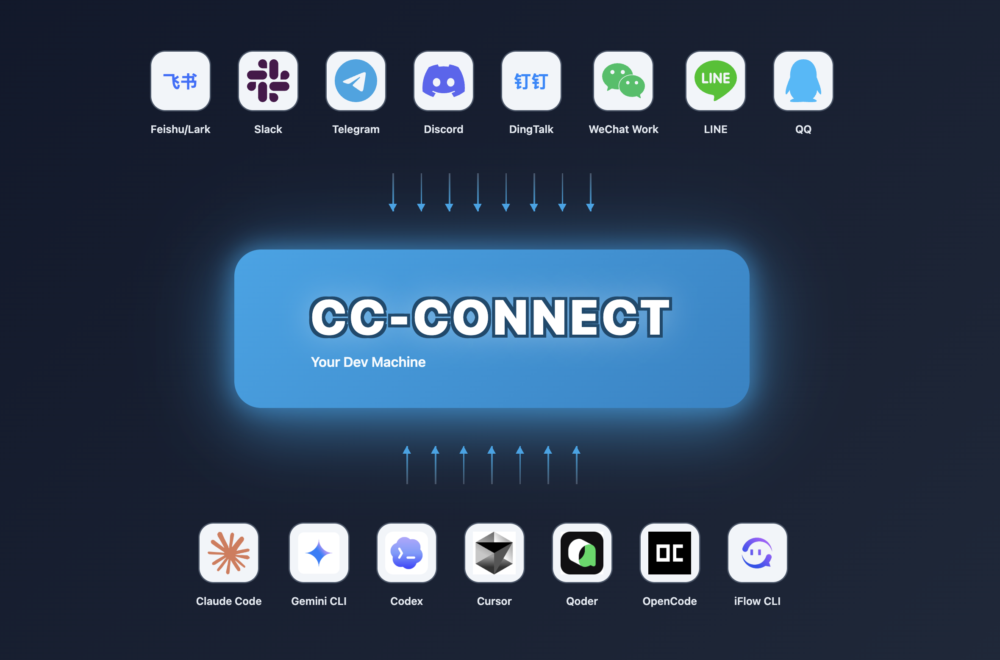
</p>


## 🆕 Что нового в v1.5.1-beta.1

Бета-версия после стабильного выпуска v1.5.0 — 16 объединённых PR. Основные изменения:

- **i18n** — системные инструкции агента (cron/timer/send/relay) локализованы в соответствии с настройкой языка (#1721).
- **Cursor** — изображения передаются в Cursor CLI через пути к файлам на диске (#1709).
- **Feishu** — большие файлы скачиваются частями через HTTP Range, что позволяет избежать code=234037 (#1746); если определить open_id бота не удалось, операция безопасно останавливается (#1725).
- **Weixin** — для ответов и инициативных отправок теперь действуют отдельные лимиты отправки (#1743); устранение дубликатов входящих сообщений стало настраиваемым (#1733).
- **Claude Code** — удаление `--replay-user-messages` восстановило работу `/compact` и других команд с косой чертой (#1737); время завершения сессии ограничено (#1714).
- **Codex** — ошибки выполнения запросов app-server передаются дальше (#1730); поддерживается уровень рассуждений max (#1727); `/list` правильно читает названия сессий (#1639).
- **Pi** — вложения передаются как ссылки `@path` (#1724); исправлена сборка для Windows (#1738).

Изменений, нарушающих обратную совместимость, нет. Полный список изменений — в `changelogs/v1.5.1-beta.1.md`.


## 🧩 Обзор возможностей платформ

Краткое сравнение возможностей **встроенных платформ** в cc-connect.

**Условные обозначения**

| Символ | Значение |
|--------|---------|
| ✅ | Работает в **стабильной версии** cc-connect с типовой конфигурацией |
| ⚠️ | Частичная поддержка, нужна дополнительная настройка (например, речи / ASR) или есть ограничения приложения либо API поставщика |
| ❌ | Не поддерживается или неприменимо на практике |

† **QQ (NapCat / OneBot)** — неофициальный мост, который нужно разместить самостоятельно; работа зависит от настроек NapCat и сети.

| Возможность | Feishu | WPS Xiezuo | DingTalk | Telegram | Slack | Discord | LINE | WeCom | Weibo | **Weixin**<br>*(личный аккаунт)* | QQ† | QQ Bot | Matrix |
|------------|:------:|:----------:|:--------:|:--------:|:-----:|:-------:|:----:|:-----:|:-----:|:-------------------------:|:---:|:------:|:------:|
| Текст и команды с косой чертой | ✅ | ✅ | ✅ | ✅ | ✅ | ✅ | ✅ | ✅ | ✅ | ✅ | ✅ | ✅ | ✅ |
| Markdown / карточки | ✅ | ✅ | ✅ | ✅ | ✅ | ✅ | ⚠️ | ⚠️ | ❌ | ✅ | ✅ | ✅ | ⚠️ |
| Потоковые ответы / ответы частями | ✅ | ✅ | ✅ | ✅ | ✅ | ✅ | ✅ | ✅ | ✅ | ✅ | ✅ | ✅ | ✅ |
| Изображения и файлы | ✅ | ❌ | ✅ | ✅ | ✅ | ✅ | ⚠️ | ✅ | ❌ | ✅ | ✅ | ✅ | ✅ |
| Голос / STT / TTS | ⚠️ | ❌ | ⚠️ | ✅ | ⚠️ | ⚠️ | ❌ | ⚠️ | ❌ | ✅ | ⚠️ | ⚠️ | ❌ |
| Личные сообщения (DM) | ✅ | ✅ | ✅ | ✅ | ✅ | ✅ | ✅ | ✅ | ✅ | ✅ | ✅ | ✅ | ✅ |
| Группы / каналы | ✅ | ✅ | ✅ | ✅ | ✅ | ✅ | ⚠️ | ✅ | ❌ | ✅ | ✅ | ✅ | ✅ |

> **WeCom:** для режима Webhook нужен **публично доступный URL**; при постоянном соединении / WS он обычно не требуется.
>
> **Строка «Голос»:** для многих платформ нужно включить провайдеров `[speech]` / TTS в `config.toml`; таблица даёт обобщённое представление о поддержке.
> Инструкции для каждой платформы приведены ниже: [руководства по подключению платформ](#-руководства-по-подключению-платформ).


## ✨ Почему cc-connect?

### 🤖 Широкая поддержка ИИ-агентов
**Более 10 ИИ-агентов** — Claude Code, Codex, Cursor Agent, Kimi CLI, Qoder CLI, Gemini CLI, OpenCode, iFlow CLI, Pi, Devin, Copilot, а также любые агенты с поддержкой [Agent Client Protocol (ACP)](https://agentclientprotocol.com/get-started/agents). Выберите подходящий для вашей работы или используйте все одновременно.

### 📱 Выбор платформы
**13 платформ для общения** — Feishu, WPS Xiezuo, DingTalk, Slack, Telegram, Discord, WeChat Work, Weibo, LINE, QQ, QQ Bot (официальный), Matrix, а также **Weixin (личный аккаунт через ilink)** для **личного WeChat**. Большинству платформ **не нужен публичный IP-адрес**.

### 🔄 Совместная работа нескольких ИИ-агентов
**Обмен сообщениями между ботами** — привяжите несколько ботов к групповому чату, чтобы они могли общаться друг с другом. Задайте вопрос Claude и получите взгляд Gemini — в одной беседе.

### 🎮 Полное управление из чата
**Всё управление в чате** — переключайте модели (`/model`), настраивайте глубину рассуждений (`/reasoning`), меняйте режимы разрешений (`/mode`) и управляйте сессиями командами с косой чертой.

**Смена рабочего каталога из чата** — задайте каталог для запуска следующей сессии командой `/dir <path>` (или совместимым псевдонимом `/cd <path>`). Для быстрого перехода по истории используйте `/dir <number>` / `/dir -`.

### 🧠 Постоянная память
**Память агента** — читайте и редактируйте файлы инструкций агента (`/memory`), не открывая терминал.

### ⏰ Планирование задач
**Периодический запуск задач** — создавайте задания Cron на естественном языке. Достаточно попросить: *«Каждый день в 6 утра составляй сводку GitHub Trending»*.

### 🎤 Мультимодальность
**Голос и изображения** — отправляйте голосовые сообщения или скриншоты; cc-connect возьмёт на себя STT/TTS и передачу мультимодальных данных.

### 📦 Несколько проектов
**Работа с несколькими проектами** — один процесс обслуживает несколько проектов, у каждого своя связка агента и платформы.

### 🌍 Многоязычный интерфейс
**5 языков** — встроенная поддержка английского, китайского (упрощённого и традиционного), японского и испанского. Встроенная локализация делает интерфейс удобнее для пользователей разных языков.


<p align="center">
  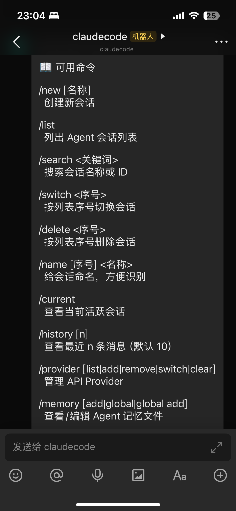
  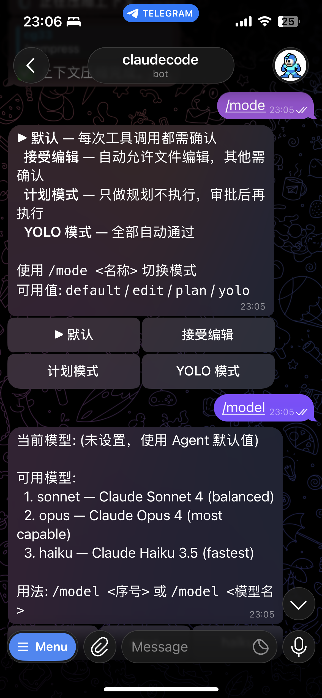
  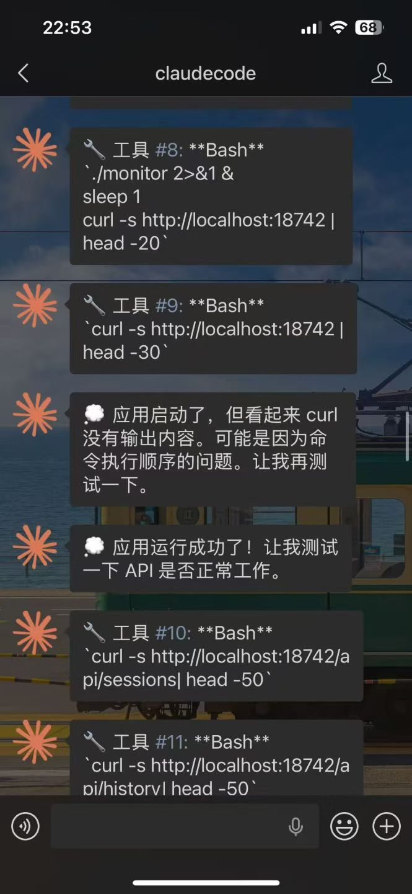
</p>
<p align="center">
  <em>Слева: Lark &nbsp;|&nbsp; Telegram &nbsp;|&nbsp; Справа: WeChat</em>
</p>


## 📋 Подготовка

> **Соблюдайте именно этот порядок установки** — cc-connect служит мостом для локальных ИИ-агентов программирования, поэтому CLI агента нужно установить и авторизовать *до* запуска cc-connect. Если пропустить эти шаги, `cc-connect` завершится с ошибкой `claudecode: claude CLI not found in PATH` (или аналогичной для выбранного агента), и веб-интерфейс на `:9820` не запустится.

### 1️⃣ Установите CLI ИИ-агента

Выберите агента, которого хотите подключить. Нужен **хотя бы один**.

```bash
# Claude Code (самый распространённый вариант)
brew install --cask claude-code            # macOS / Linux Homebrew
# или
npm install -g @anthropic-ai/claude-code   # любая платформа через npm

# OpenAI Codex
npm install -g @openai/codex

# Google Gemini CLI
npm install -g @google/gemini-cli

# iFlow CLI
npm install -g @iflow-ai/iflow-cli

# Qoder CLI
curl -fsSL https://qoder.com/install | bash
```

Для **Cursor Agent** и **OpenCode** воспользуйтесь официальными инструкциями по установке:
- Cursor Agent: <https://docs.cursor.com/agent>
- OpenCode: <https://github.com/opencode-ai/opencode>

Убедитесь, что исполняемый файл доступен через `PATH`:

```bash
claude --version       # или: codex / gemini / opencode / qodercli / cursor-agent ...
```

### 2️⃣ Авторизуйте агента

У каждого агента своя процедура входа. Один раз запустите его интерактивно, чтобы он сохранил учётные данные в вашем домашнем каталоге:

```bash
claude login           # откроет браузер для авторизации
# или
codex login            # /gemini / opencode auth — см. документацию агента
```

Если пропустить этот шаг, `cc-connect` запустится, но агент будет отклонять каждый запрос с ошибкой авторизации.

### 3️⃣ Установите cc-connect

```bash
# npm (любая платформа)
npm install -g cc-connect

# Homebrew (macOS / Linux)
brew install cc-connect

# Или скачайте исполняемый файл с https://github.com/chenhg5/cc-connect/releases
```

### 4️⃣ Запустите cc-connect и откройте веб-интерфейс

```bash
cc-connect             # запускает сервис; при первом запуске автоматически создаёт ~/.cc-connect/config.toml
```

При первом запуске cc-connect выведет примерно следующее:

```
Web admin:  http://localhost:9820
```

Откройте этот URL в браузере. Если порт `9820` уже занят, передайте `--web-port 9821` или задайте `web_port` в `config.toml`.

> **Примечание:** `cc-connect web` *только* открывает браузер и интерфейс настройки — сервис эта команда **не запускает**. Нужно также запустить `cc-connect` в другом терминале.

### 5️⃣ Настройте токены ботов платформ в веб-интерфейсе

Создайте проект в веб-интерфейсе, добавьте хотя бы одну платформу (Feishu / Telegram / Discord / Slack / DingTalk / WeChat Work / QQ / LINE / Weixin) и вставьте токен бота из консоли разработчика этой платформы. Сохраните настройки — cc-connect применит их без перезапуска.

Готово: отправьте сообщение своему боту, и cc-connect передаст его локальному агенту.

---

## 🚀 Быстрый старт

### 🤖 Установка и настройка с помощью ИИ-агента (рекомендуется)

> **Самый простой способ** — отправьте этот текст в Claude Code или другому ИИ-агенту программирования, и он выполнит всю установку и настройку за вас:

```bash
Follow https://raw.githubusercontent.com/chenhg5/cc-connect/refs/heads/main/INSTALL.md to install and configure cc-connect.
```


### 📦 Установка вручную

**Через npm:**

```bash
npm install -g cc-connect
```

**Через Homebrew (macOS / Linux):**

```bash
brew install cc-connect
```

**Скачайте исполняемый файл из [GitHub Releases](https://github.com/chenhg5/cc-connect/releases):**

```bash
# Linux amd64 — стабильная версия
curl -L -o cc-connect https://github.com/chenhg5/cc-connect/releases/latest/download/cc-connect-linux-amd64
chmod +x cc-connect
sudo mv cc-connect /usr/local/bin/

```

**Сборка из исходников (требуется Go 1.22+):**

```bash
git clone https://github.com/chenhg5/cc-connect.git
cd cc-connect
make build
```


### ⚙️ Настройка

> **💡 Совет: используйте веб-интерфейс для настройки** — после установки выполните `cc-connect web`, чтобы настроить веб-панель администрирования и открыть её в браузере. В ней можно создавать проекты, добавлять платформы, управлять провайдерами и общаться с агентом, не редактируя TOML-файлы вручную. **Примечание:** `cc-connect web` выполняет только настройку и открывает браузер; для запуска сервиса нужно отдельно выполнить `cc-connect`.

Если предпочитаете настроить всё вручную:

```bash
mkdir -p ~/.cc-connect
cp config.example.toml ~/.cc-connect/config.toml
vim ~/.cc-connect/config.toml
```

Укажите `admin_from = "alice,bob"` в конфигурации проекта, чтобы разрешить пользователям с этими ID выполнять привилегированные команды, например `/dir` и `/shell`.
Параметр `admin_from` должен находиться в `[[projects]]`, а не в `[projects.platforms.options]`. Узнать свой текущий `User ID` можно командами `/whoami` или `/status`.
При выполнении `/dir reset` cc-connect восстанавливает настроенный `work_dir` и удаляет сохранённое переопределение каталога из `data_dir/projects/<project>.state.json`.


### ▶️ Запуск

```bash
./cc-connect
```


### 🔄 Обновление

```bash
# npm
npm install -g cc-connect

# Homebrew
brew upgrade cc-connect

# Самообновление исполняемого файла
cc-connect update           # стабильная версия
cc-connect update --pre     # включая предварительные выпуски
```


## 📊 Поддерживаемые компоненты

| Компонент | Тип | Статус |
|-----------|------|--------|
| Агент | Claude Code | ✅ Поддерживается |
| Агент | Codex (OpenAI) | ✅ Поддерживается |
| Агент | Cursor Agent | ✅ Поддерживается |
| Агент | Gemini CLI (Google) | ✅ Поддерживается |
| Агент | Qoder CLI | ✅ Поддерживается |
| Агент | OpenCode (Crush) | ✅ Поддерживается |
| Агент | iFlow CLI | ✅ Поддерживается |
| Агент | Kimi CLI (Moonshot) | ✅ Поддерживается |
| Агент | Pi (Cursor Background Agent) | ✅ Поддерживается |
| Агент | Copilot (GitHub) | ✅ Поддерживается |
| Агент | ACP (Agent Client Protocol) | ✅ Любой [агент с поддержкой ACP](https://agentclientprotocol.com/get-started/agents) |
| Агент | Devin (Cognition) | ✅ Поддерживается (через ACP) |
| Агент | Goose (Block) | 🔜 Запланировано |
| Агент | Aider | 🔜 Запланировано |
| Платформа | Feishu (Lark) | ✅ WebSocket — публичный IP-адрес не нужен |
| Платформа | DingTalk | ✅ Stream — публичный IP-адрес не нужен |
| Платформа | WPS Xiezuo | ✅ WebSocket — публичный IP-адрес не нужен |
| Платформа | Telegram | ✅ Long Polling — публичный IP-адрес не нужен |
| Платформа | Slack | ✅ Socket Mode — публичный IP-адрес не нужен |
| Платформа | Discord | ✅ Gateway — публичный IP-адрес не нужен |
| Платформа | Weibo | ✅ WebSocket — публичный IP-адрес не нужен |
| Платформа | LINE | ✅ Webhook — нужен публично доступный URL |
| Платформа | WeChat Work | ✅ WebSocket / Webhook |
| Платформа | Weixin (личный аккаунт, ilink) | ✅— HTTP long polling — публичный IP-адрес не нужен |
| Платформа | QQ (NapCat/OneBot) | ✅ WebSocket |
| Платформа | QQ Bot (официальный) | ✅ WebSocket — публичный IP-адрес не нужен |
| Платформа | Matrix | ✅ Long Polling (/sync) — публичный IP-адрес не нужен |


## 📖 Руководства по подключению платформ

| Платформа | Руководство | Подключение | Нужен публичный IP? |
|----------|-------|------------|------------|
| Feishu (Lark) | [docs/feishu.md](docs/feishu.md) | WebSocket | Нет |
| DingTalk | [docs/dingtalk.md](docs/dingtalk.md) | Stream | Нет |
| WPS Xiezuo | [docs/wps-xiezuo.md](docs/wps-xiezuo.md) | WebSocket | Нет |
| Telegram | [docs/telegram.md](docs/telegram.md) | Long Polling | Нет |
| Slack | [docs/slack.md](docs/slack.md) | Socket Mode | Нет |
| Google Chat | [docs/googlechat.md](docs/googlechat.md) | Cloud Pub/Sub | Нет |
| Discord | [docs/discord.md](docs/discord.md) | Gateway | Нет |
| Weibo | [docs/weibo.md](docs/weibo.md) | WebSocket | Нет |
| WeChat Work | [docs/wecom.md](docs/wecom.md) | WebSocket / Webhook | Нет (WS) / Да (Webhook) |
| Weixin (личный аккаунт) | [docs/weixin.md](docs/weixin.md) | HTTP long polling (ilink) | Нет |
| QQ / QQ Bot | [docs/qq.md](docs/qq.md) | WebSocket | Нет |
| Matrix | [docs/matrix.md](docs/matrix.md) | /sync (Long Polling) | Нет |


## 🎯 Основные возможности

### 💬 Управление сессиями

```
/new [name]       Начать новую сессию
/list             Показать все сессии
/switch <id>      Переключить сессию
/current          Показать текущую сессию
/dir [path|reset] Показать, сменить или сбросить рабочий каталог
```

В конфигурации проекта предусмотрен автоматический переход к новой сессии после длительного простоя. Это предотвращает «смещение контекста»: устаревшая история чата (неудачные команды, отладочный шум) повторно передаётся через `--continue` и начинает перетягивать на себя внимание модели. Предыдущая сессия сохраняется и остаётся доступной через `/list` и `/switch`.

```toml
[[projects]]
reset_on_idle_mins = 30   # значение по умолчанию; укажите 0, чтобы отключить
```

Если параметр не задан, используется значение **30 минут**. Укажите `reset_on_idle_mins = 0`, чтобы отключить автоматическую смену сессии и всегда продолжать предыдущую.

### 🛡️ Изоляция на уровне пользователей ОС (`run_as_user`)

В Linux/macOS проект может запускать агента от имени другого пользователя Unix,
обеспечивая изоляцию файловой системы средствами ОС от пользователя,
который запускает и контролирует cc-connect. Сейчас это поддерживает Claude Code.

```toml
[[projects]]
name = "claude-sandboxed"
run_as_user = "partseeker-coder"
run_as_env = ["PGSSLROOTCERT"]
```

Пользователю, запускающему cc-connect, нужен беспарольный sudo для запуска от имени целевого пользователя.
У самого целевого пользователя не должно быть прав sudo; ему нужны права чтения и записи в `work_dir`
и собственный `~/.claude/settings.json` с необходимыми агенту учётными данными.
При авторизации через OAuth `claude.ai` создайте символическую ссылку
`~/.claude/.credentials.json` целевого пользователя на копию этого файла у пользователя,
запускающего cc-connect, чтобы обновления токенов оставались синхронизированными. Подробнее —
в [списке проверок переноса окружения](./docs/usage.md#environment-propagation-what-moves-into-the-target-users-home).
Полная инструкция по настройке доступна
в [`docs/usage.md`](./docs/usage.md#running-agents-as-a-different-unix-user-run_as_user).

Перед запуском cc-connect проверьте настройки:

```bash
cc-connect doctor user-isolation
```

Команда выполняет три обязательные предварительные проверки и проверку изоляции,
показывая, что целевой пользователь может и не может читать. cc-connect откажется
запускаться, если хотя бы одна проверка не пройдена или обнаружен доступ к чужим данным.

---

### 🔐 Режимы разрешений

```
/mode             Показать доступные режимы
/mode yolo        # Автоматически разрешать вызовы всех инструментов
/mode default     # Показывать запрос разрешения для каждого инструмента
```


### 🔄 Управление провайдерами

```
/provider list              Показать провайдеров
/provider switch <name>     Сменить провайдера API без перезапуска
```


### 🤖 Выбор модели

```
/model                      Показать доступные модели (формат: alias - model)
/model switch <alias>       Выбрать модель по псевдониму
```


### 📂 Рабочий каталог

```
/dir                         Показать текущий рабочий каталог и историю
/dir <path>                  Перейти по относительному или абсолютному пути
/dir <number>                Выбрать каталог из истории
/dir -                       Вернуться в предыдущий каталог
/cd <path>                   Совместимый псевдоним для /dir <path>
```


### ⏰ Периодический запуск задач

```bash
/cron add 0 6 * * * Summarize GitHub trending
```

### 📎 Отправка вложений агентом в чат

Когда агент создаёт локальный скриншот, диаграмму, PDF, архив или другой файл, он может отправить его вложением в текущий чат.

В первом выпуске поддерживаются:
- Feishu
- Telegram

Если ваш агент не поддерживает нативное добавление системных инструкций, после обновления один раз выполните в чате:

```text
/bind setup
```

или:

```text
/cron setup
```

Это обновит инструкции cc-connect в файле памяти проекта, чтобы агент знал, как отправлять вложения в чат.

Этой возможностью можно управлять глобально в `config.toml`:

```toml
attachment_send = "on"  # по умолчанию "on"; "off" запрещает отправку изображений и файлов в чат
```

Переключатель не зависит от `/mode` агента и управляет только `cc-connect send --image/--file`. Отправка голосовых сообщений регулируется настройками TTS.

Примеры:

```bash
cc-connect send --image /absolute/path/to/chart.png
cc-connect send --file /absolute/path/to/report.pdf
cc-connect send --file /absolute/path/to/report.pdf --image /absolute/path/to/chart.png
cc-connect send --tts "Hello from cc-connect"
```

Примечания:
- Надёжнее всего использовать абсолютные пути.
- Флаги `--image` и `--file` можно указывать несколько раз.
- `--tts` отправляет синтезированную речь, когда пользователь просит голосовой ответ.
- `attachment_send = "off"` отключает только отправку вложений; обычные текстовые ответы продолжают работать.
- По умолчанию размер вложения ограничен 50 MiB; лимит задаётся через `max_attachment_size_mb` или переменную окружения `CC_MAX_ATTACHMENT_SIZE_MB` (также в MiB).
- Эта команда предназначена для отправки созданных вложений, а не обычных текстовых ответов.

📖 **Полная документация:** [docs/usage.md](docs/usage.md)


## 📚 Документация

- [Руководство пользователя](docs/usage.md) — полная документация по возможностям
- [INSTALL.md](INSTALL.md) — инструкция по установке, удобная для ИИ-агентов
- [config.example.toml](config.example.toml) — шаблон конфигурации
- [CONTRIBUTING.md](CONTRIBUTING.md) — как сообщать о проблемах и предлагать изменения через pull request


## 👥 Сообщество

- [Discord](https://discord.gg/kHpwgaM4kq)
- [Telegram](https://t.me/+odGNDhCjbjdmMmZl)


## ☕ Поддержать проект

Если cc-connect оказался вам полезен, угостите нас кофе! Ваша поддержка помогает нам:

- 🛠️ Поддерживать и улучшать проект
- 📚 Писать более качественную документацию и учебные материалы
- 🐛 Быстрее исправлять ошибки и добавлять новые возможности
- ☕ Обеспечивать разработчиков кофе

### Как сделать пожертвование

**Buy Me a Coffee**: [https://buymeacoffee.com/cg33](https://buymeacoffee.com/cg33)

**WeChat Pay / Alipay**:

| WeChat Pay | Alipay |
|:----------:|:------:|
|  |  |

### Спасибо всем, кто поддержал проект! 🎉

Мы благодарны каждому, кто поддержал проект. Если хотите попасть в этот список, укажите своё имя пользователя GitHub в комментарии к пожертвованию!

<!-- Здесь перечислены пользователи, поддержавшие проект -->
| Аватар | Имя пользователя GitHub | Дата |
|--------|-----------------|------|
|  | [@thx0701](https://github.com/thx0701) | 2026-04-29 |


## 🤝 Коммерческое сотрудничество

Мы открыты к следующим форматам коммерческого сотрудничества:

- **Корпоративная адаптация**: индивидуальное развёртывание для внутренних ИИ-инструментов (Feishu, DingTalk, WeChat Work, Slack и др.)
- **Технические консультации**: интеграция ИИ-агентов и проектирование архитектуры
- **Заказная разработка**: создание систем с использованием ИИ

**Контакты**: **Электронная почта**: chg80333@gmail.com | **WeChat**: mongorz | [Telegram](https://t.me/+odGNDhCjbjdmMmZl) | [Discord](https://discord.gg/kHpwgaM4kq)


## 🙏 Участники проекта

<a href="https://github.com/chenhg5/cc-connect/graphs/contributors">
  
</a>


## ⭐ История звёзд GitHub

<a href="https://www.star-history.com/#chenhg5/cc-connect&Date">
 <picture>
   <source media="(prefers-color-scheme: dark)" srcset="https://api.star-history.com/svg?repos=chenhg5/cc-connect&type=Date&theme=dark" />
   <source media="(prefers-color-scheme: light)" srcset="https://api.star-history.com/svg?repos=chenhg5/cc-connect&type=Date" />
   
 </picture>
</a>


## 📄 Лицензия

Лицензия MIT


<p align="center">
  <sub>Создано с ❤️ сообществом cc-connect</sub>
</p>
