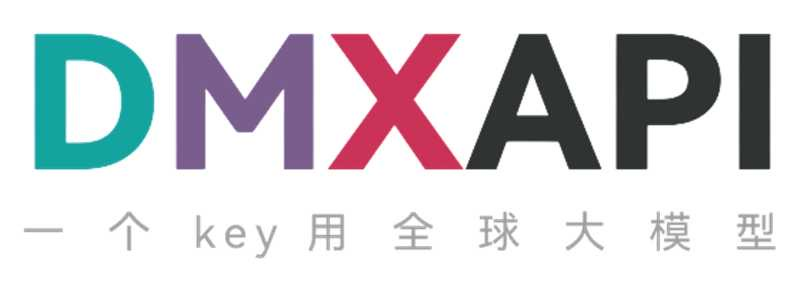

<p align="center">
  
</p>

<p align="center">
  <a href="https://github.com/chenhg5/cc-connect/actions/workflows/ci.yml">
    
  </a>
  <a href="https://github.com/chenhg5/cc-connect/releases">
    
  </a>
  <a href="https://www.npmjs.com/package/cc-connect">
    
  </a>
  <a href="https://github.com/chenhg5/cc-connect/blob/main/LICENSE">
    
  </a>
  <a href="https://goreportcard.com/report/github.com/chenhg5/cc-connect">
    
  </a>
</p>

<p align="center">
  <a href="https://discord.gg/kHpwgaM4kq">
    
  </a>
  <a href="https://t.me/+odGNDhCjbjdmMmZl">
    
  </a>
</p>

<p align="center">
  <a href="./README.md">English</a> | <a href="./README.zh-CN.md">中文</a>
</p>

<p align="center">
  <a href="https://trendshift.io/repositories/23266" target="_blank">
    
  </a>
</p>


## ❤️ 赞助

> 想在这里展示？联系：chg80333@gmail.com | 微信：mongorz

<details open>
<summary>赞助商</summary>

[](https://www.kimi.com/code/?aff=cc-connect)

感谢 [Kimi](https://www.kimi.com/code/?aff=cc-connect) 赞助本项目！[Kimi K3](https://www.kimi.com/blog/kimi-k3) 是 Moonshot AI 迄今能力最强的模型，也是全球首个开源 3T 级模型。K3 拥有 2.8T 参数、原生视觉能力与 100 万 Token 上下文，在长程编码、知识工作和推理任务中展现前沿性能。

通过 cc-connect，你可以将本地运行的 Kimi CLI 连接到飞书、钉钉、Telegram、Slack、Discord、企业微信等即时通讯工具，随时让 Kimi 阅读和修改代码、排查问题、执行命令与处理自动化任务。

cc-connect 已支持 Kimi CLI。立即体验 **Kimi Code 订阅**（[中文站](https://www.kimi.com/code?aff=cc-connect)｜[Global](https://www.kimi.ai/code?aff=cc-connect)），或前往 Kimi 开放平台（[中文站](https://platform.kimi.com?track_id=track-78c5d46574a54286a4ff42f7331272ba&aff=cc-connect)｜[Global](https://platform.kimi.ai?track_id=track-dd37b0bea7a64b99b3fe2217b398e20b&aff=cc-connect)）使用 API。

---

<table>
<tr>
<td width="150"><a href="https://apinebula.com/UrO0q1"></a></td>
<td>感谢 APINEBULA 赞助本项目！APINEBULA 是银河录像局旗下的企业级 AI 聚合平台，背靠大平台资源，面向开发者、团队与企业用户提供稳定、高性价比的大模型 API 接入服务。平台聚合 Claude、GPT、Gemini等主流满血模型，一个接口，接入全球顶尖AI大模型，各大模型价格低至 1 折起，支持企业级高并发、正式合同、对公打款与开票服务，适合 AI 编程、Agent 开发、业务系统集成等多种场景！使用此链接注册并在充值时填写"ccconnect"优惠码可享九折优惠！</td>
</tr>

<tr>
<td width="150"><a href="https://s.qiniu.com/aUbueu"></a></td>
<td>感谢 <a href="https://s.qiniu.com/aUbueu">七牛云 AI</a> 赞助本项目！七牛云（02567.HK）旗下企业级 MaaS 平台，一站式调用全球 150+ 主流模型，兼容全球主流模型厂商协议，覆盖文本、图像、音频、视频、文件处理等全模态处理能力，服务超过 169 万企业及开发者用户。专属福利：企业用户免费领 1200万 Token，邀请好友最高得百亿 Token。</td>
</tr>

<tr>
<td width="150"><a href="https://api.fenno.ai/register?redirect=/purchase?tab=subscription%26group=16&aff=C7KG6WBS7CQJ"></a></td>
<td>感谢 Fenno.ai 赞助本项目！Fenno.ai 是一家稳定、高效的 API 中转服务商，目前主要提供 Codex 中转服务，兼容 OpenAI 及 Anthropic 协议，可灵活接入 Codex、Claude Code、OpenCode 等主流编程工具，可稳定支撑千亿 Token/日的企业级调用需求，支持国内及海外主体公对公结算、开票。Fenno.ai 为 CC-Connect 的用户提供了专属福利：通过 <a href="https://api.fenno.ai/register?redirect=/purchase?tab=subscription%26group=16&aff=C7KG6WBS7CQJ">此链接</a> 即可订阅 9.9 元/150 刀额度的超值 Coding Plan，邀请好友最高可享 20% 奖励，多邀多得！</td>
</tr>

<tr>
<td width="150"><a href="https://aigocode.com/invite/CYY3C85C"></a></td>
<td>感谢 AIGoCode 对本项目的赞助！AIGoCode 是集 Claude Code、Codex、最新 Gemini 模型于一体的一站式平台，提供稳定高效、高性价比的 AI 编码服务。灵活订阅方案、零封号风险、无需 VPN 直连、响应速度极快。通过 <a href="https://aigocode.com/invite/CYY3C85C">此链接</a> 注册，首充额外获得 10% 赠送额度！</td>
</tr>

<tr>
<td width="150"><a href="https://go.apimart.ai/gh-cc-connect"></a></td>
<td>感谢 APIMart 赞助本项目！APIMart 是专注 AI 图片/视频生成的低价 API 平台，GPT-Image-2 低至 $0.006/张，1 美元可出图 160+ 张。图片、视频一套异步 API 通吃，提交任务拿 ID、回调取结果，跑批万张不超时、换模型不改代码。按量付费、无月费，通过 <a href="https://go.apimart.ai/gh-cc-connect">此注册链接</a> 注册即可开用。</td>
</tr>

<tr>
<td width="150"><a href="https://www.dmxapi.cn/register?aff=NDln"></a></td>
<td>感谢 DMXAPI（大模型API）赞助本项目！DMXAPI，一个 Key 用全球大模型。为 200+ 企业用户提供全球大模型 API 服务。充值即开票、当天开票、并发不限制、1元起充、7x24 在线技术辅导。GPT/Claude/Gemini 全部 6.8 折，国内模型 5~8 折，Claude Code 专属模型 3.4 折进行中！<a href="https://www.dmxapi.cn/register?aff=NDln">点击这里注册</a></td>
</tr>

<tr>
<td width="150"><a href="https://apikey.fun/register?aff=cc_connect"></a></td>
<td>感谢 APIKEY.FUN 赞助本项目！APIKEY.FUN 是一家专业的企业级 AI 中转站，致力于为企业和个人开发者提供稳定、高效、低成本的 AI 模型 API 接入服务。平台支持 Claude、OpenAI、Gemini 等主流热门模型，价格低至官方原价的 7%。通过<a href="https://apikey.fun/register?aff=cc_connect">此链接</a>注册，还可享受最高充值永久 95 折专属优惠！</td>
</tr>

<tr>
<td width="150"><a href="https://www.shengsuanyun.com/?from=CH_67XCLZGS"></a></td>
<td>感谢胜算云赞助了本项目！胜算云是专为 AI Native Teams 服务的超级工厂，工业级 AI 任务并行执行平台，模型商城集采直供聚合接入了 Claude、Chatgpt、Gemini 等海内外 LLM 及图片视频多媒体模型算力，绝无逆向掺水、全站模型 SLA 可用性高达 99.7%、<a href="https://watch.shengsuanyun.com/status/shengsuanyun">监测接口</a>日常全绿。更有企业级专属定制网关，实现团队精细化成本与权限管控，智能路由+安全防护+BYOK 企业自带密钥托管。平台按量及 tokens plan（即将上线）计费，可开票，使用<a href="https://www.shengsuanyun.com/?from=CH_67XCLZGS">此链接</a>注册新用户可获 10 元模力及首充 10% 赠送。</td>
</tr>

<tr>
<td width="150"><a href="https://visioncoder.cn"></a></td>
<td>感谢 VisionCoder 对本项目的支持。<a href="https://visioncoder.cn">VisionCoder 开发平台</a> 是一个可靠高效的 API 中继服务提供商，提供 Claude Code、Codex、Gemini 等主流 AI 模型，帮助开发者和团队更轻松地集成 AI 功能，提升工作效率。此外，VisionCoder 还提供 <strong>Claude Max 200</strong> 与 <strong>GPT Pro 200</strong> <strong>高级成品号</strong>的独家售卖渠道，助力体验全网顶配 AI 的算力与体验。</td>
</tr>

<tr>
<td width="150"><a href="https://runapi.co/register?aff=4BXa"></a></td>
<td>感谢 RunAPI 对本项目的赞助！RunAPI 是高效稳定的API OpenRouter平替平台，一个 API Key 即可访问 OpenAI、Claude、Gemini、DeepSeek、Grok 等 150+ 主流模型，低至 1 折，极其稳定，可以无缝兼容 Claude Code、OpenClaw 等工具。RunAPI 为 cc-connect的用户提供专属福利：注册联系管理员即可领取￥7的免费额度</td>
</tr>

<tr>
<td width="150"><a href="https://camel.kr777.top/register?aff=V2z8"></a></td>
<td>感谢 CaMeL 对本项目的赞助！携手各大科研院所、超算中心深度合作，自研高稳高效缓存调度方案。CC-Connect专享新人注册认证即送$10！通过 <a href="https://camel.kr777.top/register?aff=V2z8">此链接</a> 注册。</td>
</tr>

<tr>
<td width="150"><a href="https://unity2.ai/register?source=ccconnect"></a></td>
<td>感谢 Unity2.ai 赞助了本项目！Unity2.ai 是面向个人开发者、团队和企业的高性能 AI 模型 API 中转平台，长期服务国内头部企业，日均承载超 300 亿 token 调用，支持 5000 RPM 级高并发。支持余额计费、首充赠额、组合订阅、企业开票和专属对接。通过 <a href="https://unity2.ai/register?source=ccconnect">此链接</a> 注册可领取 $2 余额，加入官方群再送 $10 余额，最高可领 $12 免费额度。</td>
</tr>

<tr>
<td width="150"><a href="https://ergouapi.com/r/gh-cc-connect"></a></td>
<td>感谢 二狗 API (Ergou API) 赞助本项目!接入二狗,稳如老狗。二狗 API 中转站,全站 0.1x~0.2x 超低倍率,提供 Claude/GPT/Gemini 等多个国内外 100% 纯血大模型接口,顶级 IPLC 线路 + 住宅双 ISP 冗余,确保全国范围稳定低延迟访问。欢迎各位开发者、工作室 <a href="https://ergouapi.com/r/gh-cc-connect">注册使用</a>。</td>
</tr>

<tr>
<td width="150"><a href="https://cc.anyroute.io/register?aff=CR455DSQSKEV"></a></td>
<td>感谢 AnyRoute.io 对本项目的赞助！AnyRoute.io 是集 Claude Code、Codex 最新模型于一体、可靠稳定高效的 API 中转站，价格透明，最低低至官方 0.7 折，支持开票和企业高并发。通过 <a href="https://cc.anyroute.io/register?aff=CR455DSQSKEV">此链接</a> 注册即可开始使用。</td>
</tr>

<tr>
<td width="150"><a href="https://aicanapi.com/register?aff=rIEy"></a></td>
<td>感谢 aicanapi.com 对本项目的赞助！艾可API致力于为企业与开发者提供高性能、低延迟、可高并发承载的API接口服务。Claude Code 模型最低可达 1.6 折，其余模型普遍可享官方 2 折优惠，豆包 Seedance 2 真人生成服务支持免排队调用。选择艾可API，让企业级AI接口服务更简单、更高效、更具性价比。通过 <a href="https://aicanapi.com/register?aff=rIEy">此链接</a> 注册即可开始使用。</td>
</tr>

<tr>
<td width="150"><a href="https://pateway.ai/?ch=2qn568&aff=DRA4VUFS"></a></td>
<td>感谢 Pateway 对本项目的赞助！PatewayAI 是面向重度 AI 开发者、专注官方直连的高品质模型 API 中转服务商。提供 Claude 全系列与 Codex 系列模型，100% 官方源直供，不掺假不注水。计费透明，Token 级账单可逐笔核验。支持企业级高并发，可签订正式合同并开具发票。通过 <a href="https://pateway.ai/?ch=2qn568&aff=DRA4VUFS">此链接</a> 注册即送 $3 试用额度，充值低至 6 折，邀请好友双向赠送，邀请奖励可达 $150！</td>
</tr>

<tr>
<td width="150"><a href="https://cy.10dianai.com/register?aff=3FQn"></a></td>
<td>感谢 10点AI 对本项目的赞助！10dian-AI企业台是面向开发者与企业的 AI API 中转平台，聚合 GPT、Claude、Gemini、DeepSeek 等主流模型。针对生产环境专项优化，支持高并发稳定运行，有效规避接口抖动与超时问题。价格亲民性价比高、接口稳定不掉线、官方保真不参水。通过 <a href="https://cy.10dianai.com/register?aff=3FQn">此链接</a> 注册即送 ¥5 余额！</td>
</tr>

<tr>
<td width="150"><a href="https://cloud.siliconflow.cn/i/650Yh2Z7"></a></td>
<td>感谢 SiliconFlow 对本项目的支持！SiliconFlow 是高性能 AI 基础设施和模型 API 平台，提供语言、语音、图片、视频等多种模型的快速可靠访问。按量计费，多模态模型支持，高速推理，企业级稳定性，帮助开发者和团队更高效地构建和扩展 AI 应用。通过 <a href="https://cloud.siliconflow.cn/i/650Yh2Z7">此链接</a> 注册并完成实名认证，即可获得 ¥20  bonus credits！</td>
</tr>


<tr>
<td width="150"><a href="https://passport.compshare.cn/register?referral_code=H65IOClRGu5CM7nn5ykfad&ytag=GPU_YY_YX_git_cc-connect"></a></td>
<td>感谢优云智算赞助了本项目！优云智算是UCloud旗下AI云平台，提供稳定、全面的国内外模型API，仅一个key即可调用。主打包月、按次的高性价比国模Coding Plan套餐，同时提供官转稳定海外模型。支持接入 Claude Code、Codex 及 API 调用。支持企业高并发、7*24技术支持、自助开票。通过 <a href="https://passport.compshare.cn/register?referral_code=H65IOClRGu5CM7nn5ykfad&ytag=GPU_YY_YX_git_cc-connect">此链接</a> 注册的用户，可得免费5元平台体验金！</td>
</tr>

<tr>
<td width="150"><a href="https://dragoncode.codes/register?ref=23ZELCPX"></a></td>
<td>感谢 DragonCode 对本项目的支持。DragonCode 为 cc-connect 用户准备了专属福利：通过 <a href="https://dragoncode.codes/register?ref=23ZELCPX">此链接</a> 注册即可开始体验。</td>
</tr>


<tr>
<td width="150"><a href="https://code0.ai/register?aff=5cGO"></a></td>
<td>感谢 Code0 对本项目的赞助！Code0 是面向中国开发者的 AI 模型聚合 API 中转服务，统一兼容 OpenAI / Anthropic / Gemini 三种协议格式，一个 Key 即可调用全量主流模型，稳定适配 Claude Code、Codex、Gemini CLI、cc-connect 等各类 Agent 工具。固定汇率计费：充值 1.5 元人民币 = 1 美元 API 额度，价格透明、国内直连、开箱即用。通过 <a href="https://code0.ai/register?aff=5cGO">此链接</a> 注册。</td>
</tr>

<tr>
<td width="150"><a href="https://console.claudeapi.com/register?aff=GDbA"></a></td>
<td>感谢 claudeapi.com 对本项目的赞助！claudeapi 是面向中高端用户的高质量直连 Claude 服务，完整接入 Anthropic 官方第一方 Keys 和 AWS Bedrock 官方渠道——无逆向工程、无智力降级、无拼接。完整保留 Opus / Sonnet / Haiku 的官方能力、长上下文和 Tool Calling 性能。专为 Claude Code 重度用户、Agent 开发者和企业团队设计，开箱即用、企业级稳定。支持开票和团队入驻。通过 <a href="https://console.claudeapi.com/register?aff=GDbA">此链接</a> 注册。</td>
</tr>
</table>

</details>

---

<br>

<p align="center">
  <b>在任何聊天工具里，远程操控你的本地 AI Agent。随时随地，随心所欲。</b>
</p>

```
         你（手机 / 电脑 / 平板）
                    │
    ┌───────────────┼───────────────┐
    ▼               ▼               ▼
   飞书           Slack         Telegram  ...10 个平台
    │               │               │
    └───────────────┼───────────────┘
                    ▼
              ┌────────────┐
              │ cc-connect │  ← 你的开发机
              └────────────┘
              ┌─────┼─────┐
              ▼     ▼     ▼
         Claude  Gemini  Codex  ...7 个 Agent
          Code    CLI   OpenCode / iFlow
```

<p align="center">
  cc-connect 把运行在你机器上的 AI Agent 桥接到你日常使用的即时通讯工具。<br/>
  代码审查、资料研究、自动化任务、数据分析 —— 只要 AI Agent 能做的事，<br/>
  都能通过手机、平板或任何有聊天应用的设备来完成。
</p>

<p align="center">
  
</p>


## 🆕 v1.5.1-beta.1 更新了什么

自 v1.5.0 正式版以来的 beta —— 16 个已合并 PR。亮点：

- **i18n** — 按 language 配置本地化 agent system prompt（cron/timer/send/relay）(#1721)。
- **Cursor** — 图片附件通过 on-disk path 传给 Cursor CLI (#1709)。
- **飞书** — 大文件 HTTP Range 分块下载，绕过 code=234037 (#1746)；bot open_id 发现失败 fail-closed (#1725)。
- **微信** — 回复/推送分路径 send budget (#1743)；入站 dedup 可配置 (#1733)。
- **Claude Code** — 移除 `--replay-user-messages`，恢复 `/compact` 等 slash 命令 (#1737)；session teardown 竞态修复 (#1714)。
- **Codex** — 传播 app-server turn 失败 (#1730)；支持 max reasoning effort (#1727)；`/list` 正确读 session 名 (#1639)。
- **Pi** — 附件 @path 引用而非 inline bytes (#1724)；Windows 编译修复 (#1738)。

无任何破坏性变更。完整 changelog 见 `changelogs/v1.5.1-beta.1.md`。


## 🧩 平台能力一览

内置各渠道在 cc-connect 里的大致能力对照，方便快速对比。

**图例**

| 符号 | 含义 |
|------|------|
| ✅ | **稳定版** cc-connect + 常规配置下可用 |
| ⚠️ | 部分支持、需额外配置（如语音/STT）或受厂商接口 / 应用类型限制 |
| ❌ | 不支持或实际不可用 |

† **QQ（NapCat / OneBot）** — 非官方自建桥接，体验依赖你的 NapCat 与网络环境。

| 能力 | 飞书 | WPS 协作 | 钉钉 | Telegram | Slack | Discord | LINE | 企业微信 | 微博 | **微信个人号**<br>（ilink） | QQ† | QQ 官方机器人 | Matrix |
|------|:----:|:--------:|:----:|:--------:|:-----:|:-------:|:----:|:--------:|:----:|:--------------------------:|:---:|:------------:|:-----:|
| 文本与斜杠命令 | ✅ | ✅ | ✅ | ✅ | ✅ | ✅ | ✅ | ✅ | ✅ | ✅ | ✅ | ✅ | ✅ |
| Markdown / 卡片 | ✅ | ✅ | ✅ | ✅ | ✅ | ✅ | ⚠️ | ⚠️ | ❌ | ✅ | ✅ | ✅ | ⚠️ |
| 流式 / 分片回复 | ✅ | ✅ | ✅ | ✅ | ✅ | ✅ | ✅ | ✅ | ✅ | ✅ | ✅ | ✅ | ✅ |
| 图片与文件 | ✅ | ❌ | ✅ | ✅ | ✅ | ✅ | ⚠️ | ✅ | ❌ | ✅ | ✅ | ✅ | ✅ |
| 语音 / STT / TTS | ⚠️ | ❌ | ⚠️ | ✅ | ⚠️ | ⚠️ | ❌ | ⚠️ | ❌ | ✅ | ⚠️ | ⚠️ | ❌ |
| 私聊 | ✅ | ✅ | ✅ | ✅ | ✅ | ✅ | ✅ | ✅ | ✅ | ✅ | ✅ | ✅ | ✅ |
| 群聊 / 频道 | ✅ | ✅ | ✅ | ✅ | ✅ | ✅ | ⚠️ | ✅ | ❌ | ✅ | ✅ | ✅ | ✅ |

> **企业微信：** Webhook 模式需要**公网 URL**；长连接等模式多数**不需要**。  
> **语音行：** 多数平台要在 `config.toml` 里配置 `[speech]` / TTS 等，表中为经验性归纳。  
> 分平台接入步骤见下文 [平台接入指南](#-平台接入指南)。


## ✨ 为什么选择 cc-connect？

### 🤖 通用 Agent 支持
**10+ 大 AI Agent** — Claude Code、Codex、Cursor Agent、Kimi CLI、Qoder CLI、Gemini CLI、OpenCode、iFlow CLI、Pi、Devin、Copilot，还可通过 [Agent Client Protocol (ACP)](https://agentclientprotocol.com/get-started/agents) 接入更多 Agent。按需选用，或同时使用全部。

### 📱 平台灵活性
**14 大聊天平台** — 飞书、WPS 协作、钉钉、Slack、Telegram、Discord、企业微信、如流、微博、LINE、QQ、QQ 官方机器人、Matrix，以及 **微信个人号（ilink）**。大部分平台**无需公网 IP**。

### 🔄 多 Agent 编排
**多机器人中继** — 在群聊中绑定多个机器人，让它们相互协作。问 Claude，再听 Gemini 的见解 — 同一个对话搞定。

### 🎮 完整的聊天控制
**聊天即控制** — 切换模型 (`/model`)、切换推理强度 (`/reasoning`)、切换权限模式 (`/mode`)、管理会话，全部通过斜杠命令完成。

**聊天切换工作目录** — 使用 `/dir <路径>` 切换下一次会话启动目录（`/cd <路径>` 为兼容别名），并支持 `/dir <序号>` / `/dir -` 快速在历史目录间跳转。

### 🧠 持久化记忆
**Agent 记忆** — 在聊天中直接读写 Agent 指令文件 (`/memory`)，无需回到终端。

### ⏰ 智能定时任务
**定时任务** — 自然语言创建 cron 任务。"每天早上6点总结 GitHub trending" 即刻生效。

### 🎤 多模态支持
**语音 & 图片** — 发语音或截图，cc-connect 自动处理 STT/TTS 和多模态转发。

### 📦 多项目架构
**多项目管理** — 一个进程同时管理多个项目，各自独立的 Agent + 平台组合。

### 🌍 多语言界面
**5 种语言** — 原生支持英语、中文（简体/繁体）、日语和西班牙语。内置 i18n 让每个人都能得心应手。


<p align="center">
  
  
  
</p>
<p align="center">
  <em>左：飞书 &nbsp;|&nbsp; Telegram &nbsp;|&nbsp; 右：微信</em>
</p>


## 📋 准备工作

> **请严格按照以下顺序安装** — cc-connect 是本地 AI 编程 Agent 的桥接工具，因此对应的 Agent CLI 必须先安装并完成登录认证，之后 cc-connect 才能正常启动。如果跳过前面的步骤直接启动 cc-connect，进程会直接退出并报错 `claudecode: claude CLI not found in PATH`（其他 Agent 报错类似），Web UI 在 `:9820` 也就无从访问。

### 1️⃣ 安装 AI Agent CLI

选择你要桥接的 Agent，至少装一个。

```bash
# Claude Code（最常用）
brew install --cask claude-code            # macOS / Linux Homebrew
# 或
npm install -g @anthropic-ai/claude-code   # 任意平台通过 npm

# OpenAI Codex
npm install -g @openai/codex

# Google Gemini CLI
npm install -g @google/gemini-cli

# iFlow CLI
npm install -g @iflow-ai/iflow-cli

# Qoder CLI
curl -fsSL https://qoder.com/install | bash
```

**Cursor Agent** 和 **OpenCode** 请参考各自的官方安装文档：
- Cursor Agent: <https://docs.cursor.com/agent>
- OpenCode: <https://github.com/opencode-ai/opencode>

确认可执行文件在 `PATH` 中：

```bash
claude --version       # 或 codex / gemini / opencode / qodercli / cursor-agent ...
```

### 2️⃣ 完成 Agent 登录认证

每个 Agent 都有自己的登录流程 — 先在终端交互式跑一次，让它把凭据存到你的 home 目录：

```bash
claude login           # 会在浏览器里打开授权页面
# 或
codex login            # / gemini / opencode 等也类似，请参考各自文档
```

跳过这一步的话，cc-connect 仍能启动，但 Agent 会因为未认证拒绝所有请求。

### 3️⃣ 安装 cc-connect

```bash
# npm（任意平台）
npm install -g cc-connect

# Homebrew（macOS / Linux）
brew install cc-connect

# 也可以从 https://github.com/chenhg5/cc-connect/releases 直接下载二进制
```

### 4️⃣ 启动 cc-connect 并打开 Web UI

```bash
cc-connect             # 启动服务；首次运行会自动生成 ~/.cc-connect/config.toml
```

首次启动时，cc-connect 会打印类似：

```
Web admin:  http://localhost:9820
```

在浏览器里打开该地址。如果 `9820` 已被占用，可以传 `--web-port 9821` 或在 `config.toml` 里设置 `web_port`。

> **注意：** `cc-connect web` *只* 打开浏览器和配置界面，并**不会**启动服务本身。仍需要在另一个终端里跑 `cc-connect`。

### 5️⃣ 在 Web UI 里配置平台 Bot Token

在 Web UI 里新建一个项目，然后添加至少一个平台（飞书 / Telegram / Discord / Slack / 钉钉 / 企业微信 / QQ / LINE / 微信 ilink），把该平台开发者后台的 Bot Token 粘贴进去。保存后 cc-connect 会热加载。

至此完成 — 给你的 Bot 发条消息，cc-connect 就会把它转给本地的 Agent。

---

## 🚀 快速开始

### 🤖 通过 AI Agent 安装配置（推荐）

> **最简单的方式** — 把这段话发给 Claude Code 或其他 AI 编码 Agent，它会帮你完成整个安装和配置过程：

```bash
请参考 https://raw.githubusercontent.com/chenhg5/cc-connect/refs/heads/main/INSTALL.md 帮我安装和配置 cc-connect
```


### 📦 手动安装

**通过 npm：**

```bash
# npm install -g cc-connect
```

**通过 Homebrew（macOS / Linux）：**

```bash
brew install cc-connect
```

**从 [GitHub Releases](https://github.com/chenhg5/cc-connect/releases) 下载：**

```bash
# Linux amd64 - 稳定版
curl -L -o cc-connect https://github.com/chenhg5/cc-connect/releases/latest/download/cc-connect-linux-amd64
chmod +x cc-connect
sudo mv cc-connect /usr/local/bin/

```

**从源码编译（需要 Go 1.22+）：**

```bash
git clone https://github.com/chenhg5/cc-connect.git
cd cc-connect
make build
```


### ⚙️ 配置

> **💡 推荐使用 Web UI 配置** — 安装完成后，运行 `cc-connect web` 配置 Web 管理后台并在浏览器中打开。可以可视化创建项目、添加平台、管理服务商、直接和 Agent 聊天，无需手动编辑 TOML 文件。**注意：** `cc-connect web` 仅用于配置和打开浏览器，并不会启动 cc-connect 服务本身，你仍需单独运行 `cc-connect` 来启动。

如果你更喜欢手动配置：

```bash
mkdir -p ~/.cc-connect
cp config.example.toml ~/.cc-connect/config.toml
vim ~/.cc-connect/config.toml
```

在项目配置里设置 `admin_from = "alice,bob"` 后，只有这些用户 ID 才能执行 `/dir`、`/shell` 等特权命令。
执行 `/dir reset` 时，cc-connect 会恢复配置中的 `work_dir`，并清除保存在 `data_dir/projects/<project>.state.json` 里的目录覆盖状态。


### ▶️ 运行

```bash
./cc-connect
```


### 🔄 升级

```bash
# npm
npm install -g cc-connect

# Homebrew
brew upgrade cc-connect

# 二进制自更新
cc-connect update           # 稳定版
cc-connect update --pre     # 含预发布版本
```


## 📊 支持状态

| 组件 | 类型 | 状态 |
|------|------|------|
| Agent | Claude Code | ✅ 已支持 |
| Agent | Codex (OpenAI) | ✅ 已支持 |
| Agent | Cursor Agent | ✅ 已支持 |
| Agent | Gemini CLI (Google) | ✅ 已支持 |
| Agent | Qoder CLI | ✅ 已支持 |
| Agent | OpenCode (Crush) | ✅ 已支持 |
| Agent | iFlow CLI | ✅ 已支持 |
| Agent | Kimi CLI (Moonshot) | ✅ 已支持 |
| Agent | Pi (Cursor Background Agent) | ✅ 已支持 |
| Agent | Copilot (GitHub) | ✅ 已支持 |
| Agent | ACP (Agent Client Protocol) | ✅ 支持任何 [ACP 兼容 Agent](https://agentclientprotocol.com/get-started/agents) |
| Agent | Devin (Cognition) | ✅ 已支持（通过 ACP）|
| Agent | Goose (Block) | 🔜 计划中 |
| Agent | Aider | 🔜 计划中 |
| Platform | 飞书 (Lark) | ✅ WebSocket — 无需公网 IP |
| Platform | 钉钉 | ✅ Stream — 无需公网 IP |
| Platform | WPS 协作 | ✅ WebSocket — 无需公网 IP |
| Platform | Telegram | ✅ Long Polling — 无需公网 IP |
| Platform | Slack | ✅ Socket Mode — 无需公网 IP |
| Platform | Discord | ✅ Gateway — 无需公网 IP |
| Platform | 微博 | ✅ WebSocket — 无需公网 IP |
| Platform | LINE | ✅ Webhook — 需要公网 URL |
| Platform | 企业微信 | ✅ WebSocket / Webhook |
| Platform | 微信个人号（ilink） | ✅— HTTP 长轮询 — 无需公网 IP |
| Platform | QQ (NapCat/OneBot) | ✅ WebSocket |
| Platform | QQ 官方机器人 | ✅ WebSocket — 无需公网 IP |
| Platform | Matrix | ✅ Long Polling (/sync) — 无需公网 IP |


## 📖 平台接入指南

| 平台 | 指南 | 连接方式 | 需要公网 IP? |
|------|------|---------|-------------|
| 飞书 (Lark) | [docs/feishu.md](docs/feishu.md) | WebSocket | 不需要 |
| 钉钉 | [docs/dingtalk.md](docs/dingtalk.md) | Stream | 不需要 |
| WPS 协作 | [docs/wps-xiezuo.md](docs/wps-xiezuo.md) | WebSocket | 不需要 |
| Telegram | [docs/telegram.md](docs/telegram.md) | Long Polling | 不需要 |
| Slack | [docs/slack.md](docs/slack.md) | Socket Mode | 不需要 |
| Discord | [docs/discord.md](docs/discord.md) | Gateway | 不需要 |
| 微博 | [docs/weibo.md](docs/weibo.md) | WebSocket | 不需要 |
| 企业微信 | [docs/wecom.md](docs/wecom.md) | WebSocket / Webhook | 不需要 (WS) / 需要 (Webhook) |
| 如流 (企业自研) | [docs/ruliu.md](docs/ruliu.md) | Webhook（公网/企业网关） | 需要 |
| 微信个人号（ilink） | [docs/weixin.md](docs/weixin.md) | HTTP 长轮询（ilink） | 不需要 |
| QQ / QQ 机器人 | [docs/qq.md](docs/qq.md) | WebSocket | 不需要 |
| Matrix | [docs/matrix.md](docs/matrix.md) | /sync（长轮询） | 不需要 |

### 如流多机器人配置（同一群聊接入多个机器人）

如流每个机器人都需要独立的公网回调地址。如果你在同一群聊中运行两个机器人（如 Codex + Claude Code），可以使用内置的 `proxy.go` 将两个回调路径汇聚到同一端口，再通过 ngrok 或反向代理对外暴露。

**第一步 — 在 config.toml 中配置两个项目，使用不同端口：**

```toml
# Codex 机器人 — 监听 :8082/ruliu/callback
[[projects]]
name = "codex-ruliu"
[projects.agent]
type = "codex"
[projects.agent.options]
work_dir = "/path/to/project"
mode = "full-auto"

[[projects.platforms]]
type = "ruliu"
[projects.platforms.options]
webhook = "https://openapi.im.baidu.com/你的-codex-机器人-webhook"
token = "your-codex-token"
encoding_aes_key = "your-22-char-key"
port = "8082"
share_session_in_group = true

# Claude Code 机器人 — 监听 :8083/ruliu/callback
[[projects]]
name = "claudecode-ruliu"
[projects.agent]
type = "claudecode"
[projects.agent.options]
work_dir = "/path/to/project"
mode = "default"

[[projects.platforms]]
type = "ruliu"
[projects.platforms.options]
webhook = "https://openapi.im.baidu.com/你的-claude-机器人-webhook"
token = "your-claude-token"
encoding_aes_key = "your-22-char-key"
port = "8083"
share_session_in_group = true
```

**第二步 — 启动 cc-connect 和内置反向代理：**

```bash
# 启动 cc-connect
./cc-connect

# 启动内置代理（将 /ruliu/codex/* → :8082，/ruliu/cc/* → :8083）
go run proxy.go
```

**第三步 — 用 ngrok 暴露 8080 端口（免费静态域名）：**

```bash
ngrok http 8080
# 或使用你分配的固定域名：
ngrok http --url=your-static-domain.ngrok-free.dev 8080
```

**第四步 — 在如流后台配置两个机器人的回调地址：**

| 机器人 | 回调 URL |
|--------|---------|
| Codex | `https://your-domain.ngrok-free.dev/ruliu/codex/callback` |
| Claude Code | `https://your-domain.ngrok-free.dev/ruliu/cc/callback` |


## 🎯 核心功能

### 💬 会话管理

各平台快速配置示例：

```toml
# 钉钉
[[projects.platforms]]
type = "dingtalk"
[projects.platforms.options]
client_id = "dingxxxx"
client_secret = "xxxx"

# Telegram
[[projects.platforms]]
type = "telegram"
[projects.platforms.options]
token = "123456:ABC-xxx"

# Slack
[[projects.platforms]]
type = "slack"
[projects.platforms.options]
bot_token = "xoxb-xxx"
app_token = "xapp-xxx"

# Discord
[[projects.platforms]]
type = "discord"
[projects.platforms.options]
token = "your-discord-bot-token"

# LINE（需要公网 URL）
[[projects.platforms]]
type = "line"
[projects.platforms.options]
channel_secret = "xxx"
channel_token = "xxx"
port = "8080"

# 企业微信（需要公网 URL）
[[projects.platforms]]
type = "wecom"
[projects.platforms.options]
corp_id = "wwxxx"
corp_secret = "xxx"
agent_id = "1000002"
callback_token = "xxx"
callback_aes_key = "xxx"
port = "8081"
enable_markdown = false  # 设为 true 则发送 Markdown 消息（仅企业微信应用内可渲染，个人微信显示"暂不支持"）

# 如流（企业自定义机器人）
[[projects.platforms]]
type = "ruliu"
[projects.platforms.options]
webhook = "https://openapi.im.baidu.com/你的如流机器人Webhook"
token = "你设置的回调 Token"
encoding_aes_key = "你的 22 位 EncodingAESKey"
# port = "8082"
# callback_path = "/ruliu/callback"
# allow_from = "user1,user2"
# share_session_in_group = false  # true = 群内所有用户共享同一 Agent 会话

# QQ（通过 NapCat/OneBot v11，无需公网 IP）
[[projects.platforms]]
type = "qq"
[projects.platforms.options]
ws_url = "ws://127.0.0.1:3001"
allow_from = "*"  # 允许的 QQ 号，如 "12345,67890"，"*" 表示所有

# QQ 官方机器人（无需公网 IP，无需第三方适配器）
[[projects.platforms]]
type = "qqbot"
[projects.platforms.options]
app_id = "your-app-id"
app_secret = "your-app-secret"
```

## 权限模式

所有 Agent 均支持权限模式，可在运行时通过 `/mode` 命令切换。

**Claude Code** 模式（对应 `--permission-mode`）：

| 模式 | 配置值 | 行为 |
|------|--------|------|
| **默认** | `default` | 每次工具调用都需要用户确认，完全掌控。 |
| **接受编辑** | `acceptEdits`（别名: `edit`）| 文件编辑类工具自动通过，其他工具仍需确认。 |
| **计划模式** | `plan` | Claude 只做规划不执行，审批计划后再执行。 |
| **YOLO 模式** | `bypassPermissions`（别名: `yolo`）| 所有工具调用自动通过。适用于可信/沙箱环境。 |

**Codex** 模式（对应 `--ask-for-approval`）：

| 模式 | 配置值 | 行为 |
|------|--------|------|
| **建议** | `suggest` | 仅受信命令（ls、cat...）自动执行，其余需确认。 |
| **自动编辑** | `auto-edit` | 模型自行决定何时请求批准，沙箱保护。 |
| **全自动** | `full-auto` | 自动通过，工作区沙箱。推荐日常使用。 |
| **YOLO 模式** | `yolo` | 跳过所有审批和沙箱。 |

**Cursor Agent** 模式（对应 `--force` / `--mode`）：

| 模式 | 配置值 | 行为 |
|------|--------|------|
| **默认** | `default` | 信任工作区，工具调用前询问。 |
| **强制执行** | `force`（别名: `yolo`）| 自动批准所有工具调用。 |
| **规划模式** | `plan` | 只读分析，不做修改。 |
| **问答模式** | `ask` | 问答风格，只读。 |

**Gemini CLI** 模式（对应 `-y` / `--approval-mode`）：

| 模式 | 配置值 | 行为 |
|------|--------|------|
| **默认** | `default` | 每次工具调用都需要确认。 |
| **自动编辑** | `auto_edit`（别名: `edit`）| 编辑工具自动通过，其他仍需确认。 |
| **全自动** | `yolo` | 自动批准所有工具调用。 |
| **规划模式** | `plan` | 只读规划模式，不做修改。 |

**Qoder CLI** 模式：

| 模式 | 配置值 | 行为 |
|------|--------|------|
| **标准权限** | `default` | 标准权限，每次工具调用需确认。 |
| **YOLO 模式** | `yolo` | 跳过所有权限检查，自动批准。 |

**OpenCode** 模式：

| 模式 | 配置值 | 行为 |
|------|--------|------|
| **默认** | `default` | 标准模式。 |
| **全自动** | `yolo` | 自动批准所有工具调用。 |

**iFlow CLI** 模式：

| 模式 | 配置值 | 行为 |
|------|--------|------|
| **默认** | `default` | 手动审批模式。 |
| **自动编辑** | `auto-edit` | 自动编辑模式。 |
| **规划模式** | `plan` | 只读规划模式。 |
| **全自动** | `yolo` | 自动批准所有工具调用。 |

```toml
# Claude Code
[projects.agent.options]
mode = "default"
# allowed_tools = ["Read", "Grep", "Glob"]

# Codex
[projects.agent.options]
mode = "full-auto"
# model = "o3"
# reasoning_effort = "high"

# Cursor Agent
[projects.agent.options]
mode = "default"

# Gemini CLI
[projects.agent.options]
mode = "default"

# Qoder CLI
[projects.agent.options]
mode = "default"

# OpenCode
[projects.agent.options]
mode = "default"

# iFlow CLI
[projects.agent.options]
mode = "default"
```

在聊天中切换模式：

```
/mode          # 查看当前模式和所有可用模式
/mode yolo     # 切换到 YOLO 模式
/mode default  # 切换回默认模式
```

对于 Codex，也可以在聊天中切换推理强度：

```
/reasoning        # 查看当前推理强度和可用等级
/reasoning high   # 切换到 high 推理强度
/reasoning 3      # 用序号快速选择
```

## API Provider 管理

支持在运行时切换不同的 API Provider（如 Anthropic 直连、中转服务、AWS Bedrock 等），无需重启服务。Provider 凭证通过环境变量注入 Agent 子进程，不会修改本地配置文件。

### 配置 Provider

**在 `config.toml` 中：**

```toml
[projects.agent.options]
work_dir = "/path/to/project"
provider = "anthropic"   # 当前激活的 provider 名称

[[projects.agent.providers]]
name = "anthropic"
api_key = "sk-ant-xxx"

[[projects.agent.providers]]
name = "relay"
api_key = "sk-xxx"
base_url = "https://api.relay-service.com"
model = "claude-sonnet-4-20250514"

# 特殊环境（Bedrock、Vertex 等）使用 env 字段：
[[projects.agent.providers]]
name = "bedrock"
env = { CLAUDE_CODE_USE_BEDROCK = "1", AWS_PROFILE = "bedrock" }
```

**通过 CLI 命令：**

```bash
cc-connect provider add --project my-backend --name relay --api-key sk-xxx --base-url https://api.relay.com
cc-connect provider add --project my-backend --name bedrock --env CLAUDE_CODE_USE_BEDROCK=1,AWS_PROFILE=bedrock
cc-connect provider list --project my-backend
cc-connect provider remove --project my-backend --name relay
```

**从 [cc-switch](https://github.com/SaladDay/cc-switch-cli) 导入：**

如果你已经使用 cc-switch 管理 Provider，一条命令即可导入（需要 `sqlite3`）：

```bash
cc-connect provider import --project my-backend
cc-connect provider import --project my-backend --type claude     # 仅 Claude Provider
cc-connect provider import --db-path ~/.cc-switch/cc-switch.db    # 指定数据库路径
```

### 在聊天中管理 Provider

```
/provider                   查看当前 Provider
/provider list              列出所有可用 Provider
/provider add <名称> <key> [url] [model]   添加 Provider
/provider add {"name":"relay","api_key":"sk-xxx","base_url":"https://..."}
/provider remove <名称>     移除 Provider
/provider switch <名称>     切换 Provider
/provider <名称>            switch 的快捷方式
```

添加、移除、切换操作均自动持久化到 `config.toml`。切换时会自动重启 Agent 会话并加载新凭证。

**各 Agent 的环境变量映射：**

| Agent | api_key → | base_url → |
|-------|-----------|------------|
| Claude Code | `ANTHROPIC_API_KEY` | `ANTHROPIC_BASE_URL` |
| Codex | `OPENAI_API_KEY` | `OPENAI_BASE_URL` |
| Gemini CLI | `GEMINI_API_KEY` | —（使用 `env` 字段）|
| OpenCode | `ANTHROPIC_API_KEY` | —（使用 `env` 字段）|
| iFlow CLI | `IFLOW_API_KEY` / `IFLOW_apiKey` | `IFLOW_BASE_URL` / `IFLOW_baseUrl` |

Provider 配置中的 `env` 字段支持设置任意环境变量，可用于 Bedrock、Vertex、Azure、自定义代理等各种场景。

## Claude Code Router 集成

[Claude Code Router](https://github.com/musistudio/claude-code-router) 是一个强大的工具，可以将 Claude Code 请求路由到不同的模型提供商（OpenRouter、DeepSeek、Gemini 等），并支持自定义请求转换。cc-connect 现已支持与 Claude Code Router 无缝集成。

### 为什么使用 Claude Code Router？

- **多提供商支持**：路由请求到 OpenRouter、DeepSeek、Ollama、Gemini、火山引擎、SiliconFlow 等
- **模型路由**：针对不同任务使用不同模型（后台任务、思考、长上下文、网络搜索）
- **请求/响应转换**：自动适配不同提供商的 API
- **动态模型切换**：无需重启即可切换模型

### 安装配置

1. **安装 Claude Code Router**：

```bash
npm install -g @musistudio/claude-code-router
```

2. **配置 Router**（创建 `~/.claude-code-router/config.json`）：

```json
{
  "APIKEY": "your-secret-key",
  "Providers": [
    {
      "name": "openrouter",
      "api_base_url": "https://openrouter.ai/api/v1/chat/completions",
      "api_key": "sk-xxx",
      "models": ["anthropic/claude-sonnet-4", "google/gemini-2.5-pro-preview"],
      "transformer": { "use": ["openrouter"] }
    },
    {
      "name": "deepseek",
      "api_base_url": "https://api.deepseek.com/chat/completions",
      "api_key": "sk-xxx",
      "models": ["deepseek-chat", "deepseek-reasoner"],
      "transformer": { "use": ["deepseek"] }
    }
  ],
  "Router": {
    "default": "deepseek,deepseek-chat",
    "think": "deepseek,deepseek-reasoner",
    "longContext": "openrouter,google/gemini-2.5-pro-preview"
  }
}
```

3. **启动 Router**：

```bash
ccr start
```

4. **配置 cc-connect**（在 `config.toml` 中）：

```toml
[projects.agent.options]
work_dir = "/path/to/project"
mode = "default"

# Router 集成
router_url = "http://127.0.0.1:3456"        # Router URL（默认端口）
router_api_key = "your-secret-key"          # 可选：如果 router 需要认证
```

### 工作原理

配置 `router_url` 后，cc-connect 会自动：

- 设置 `ANTHROPIC_BASE_URL` 为 router URL
- 设置 `NO_PROXY=127.0.0.1` 防止代理干扰
- 禁用遥测和成本警告以获得更清洁的集成

所有 Claude Code 请求都会通过 router 路由，由 router 处理模型选择和提供商通信。

### 使用方式

配置完成后，像往常一样使用 cc-connect。Router 会透明地处理模型路由：

```
你：帮我重构这段代码
Router → DeepSeek（默认模型）

你：思考一下这个架构决策
Router → DeepSeek Reasoner（思考模型）

你：分析这个大型代码库
Router → Gemini Pro（长上下文模型）
```

### 重要说明

- **Provider 设置被忽略**：使用 router 时，`[[projects.agent.providers]]` 设置会被绕过，因为 router 管理模型选择
- **Router 必须运行**：确保在启动 cc-connect 之前执行 `ccr start`
- **配置更改**：修改 router 配置后，需要重启：`ccr restart`

更多详情请参考 [Claude Code Router 文档](https://github.com/musistudio/claude-code-router)。

## 语音消息（语音转文字）

直接发送语音消息 — cc-connect 自动将语音转为文字，再将文字转发给 Agent 处理。

**支持平台：** 飞书、企业微信、Telegram、LINE、Discord、Slack

**前置条件：**
- OpenAI 或 Groq 的 API Key（用于 Whisper 语音识别）
- 安装 `ffmpeg`（用于音频格式转换 — 大部分平台语音格式为 AMR/OGG，Whisper 不直接支持）

### 配置

```toml
[speech]
enabled = true
provider = "openai"    # "openai" 或 "groq"
language = ""          # 如 "zh"、"en"；留空自动检测

[speech.openai]
api_key = "sk-xxx"     # OpenAI API Key
# base_url = ""        # 自定义端点（可选，兼容 OpenAI 接口的服务）
# model = "whisper-1"  # 默认模型

# -- 或使用 Groq（更快更便宜） --
# [speech.groq]
# api_key = "gsk_xxx"
# model = "whisper-large-v3-turbo"
```

### 工作原理

1. 用户在任何支持的平台发送语音消息
2. cc-connect 从平台下载音频文件
3. 如需格式转换（AMR、OGG → MP3），由 `ffmpeg` 处理
4. 音频发送至 Whisper API 进行转录
5. 转录文字展示给用户，并转发给 Agent

### 安装 ffmpeg

```bash
# Ubuntu / Debian
sudo apt install ffmpeg

# macOS
brew install ffmpeg

# Alpine
apk add ffmpeg
```

## 定时任务 (Cron)

创建定时任务，自动执行 — 比如每日代码审查、定期趋势汇总、每周报告等。定时任务触发时，cc-connect 将 prompt 发送给 Agent，并将结果回传到你的聊天会话中。

### 通过斜杠命令管理

```
/cron                                          列出所有定时任务
/cron add <分> <时> <日> <月> <周> <任务描述>      创建定时任务
/cron del <id>                                 删除定时任务
/cron enable <id>                              启用任务
/cron disable <id>                             禁用任务
```

示例：

```
/cron add 0 6 * * * 帮我收集 GitHub trending 并发送总结
```

### 通过 CLI 管理

```bash
cc-connect cron add --cron "0 6 * * *" --prompt "总结 GitHub trending" --desc "每日趋势"
cc-connect cron list
cc-connect cron del <job-id>
```

### 自然语言创建定时任务（通过 Agent）

**Claude Code** 开箱即用 — 直接用自然语言告诉它：

> "每天早上6点帮我总结 GitHub trending"
> "每周一早上9点，生成周报"

Claude Code 会通过 `--append-system-prompt` 自动将你的请求转为 `cc-connect cron add` 命令。

**其他 Agent**（Codex、Cursor、Gemini CLI、Qoder CLI、OpenCode、iFlow CLI）需要在项目根目录的 Agent 指令文件中添加说明，让 Agent 知道如何创建定时任务。将以下内容添加到对应文件中：

| Agent | 指令文件 |
|-------|---------|
| Codex | `AGENTS.md` |
| Cursor | `.cursorrules` |
| Qoder CLI | `AGENTS.md`（项目级）、`~/.qoder/AGENTS.md`（全局） |
| Gemini CLI | `GEMINI.md` |
| OpenCode | `OPENCODE.md` |
| iFlow CLI | `IFLOW.md` |

**需要添加的内容：**

```markdown
# cc-connect Integration

This project is managed via cc-connect, a bridge to messaging platforms.

## Scheduled tasks (cron)
When the user asks you to do something on a schedule (e.g. "every day at 6am",
"每天早上6点"), use the Bash/shell tool to run:

  cc-connect cron add --cron "<min> <hour> <day> <month> <weekday>" --prompt "<task description>" --desc "<short label>"

Environment variables CC_PROJECT and CC_SESSION_KEY are already set — do NOT
specify --project or --session-key.

Examples:
  cc-connect cron add --cron "0 6 * * *" --prompt "Collect GitHub trending repos and send a summary" --desc "Daily GitHub Trending"
  cc-connect cron add --cron "0 9 * * 1" --prompt "Generate a weekly project status report" --desc "Weekly Report"

To list or delete cron jobs:
  cc-connect cron list
  cc-connect cron del <job-id>

## Send message to current chat
To proactively send a message back to the user's chat session (use --stdin heredoc for long/multi-line messages):

  cc-connect send --stdin <<'CCEOF'
  your message here (any special characters are safe)
  CCEOF

For short single-line messages:

  cc-connect send -m "short message"
```

## 守护进程模式

将 cc-connect 作为后台服务运行，由系统 init 管理（Linux systemd 用户服务，macOS launchd LaunchAgent）。

```bash
cc-connect daemon install --config ~/.cc-connect/config.toml   # 安装服务
cc-connect daemon install --work-dir ~/.cc-connect             # 等价写法：指定配置目录
cc-connect daemon start
cc-connect daemon stop
cc-connect daemon restart
cc-connect daemon status
cc-connect daemon logs [-f] [-n N] [--log-file PATH]
cc-connect daemon uninstall
```

**install 参数：** `--config PATH`、`--log-file PATH`、`--log-max-size N`（MB）、`--work-dir DIR`、`--force`。`--config` 传入配置文件路径，`--work-dir` 传入包含 `config.toml` 的目录。日志在达到大小限制时自动轮转，保留 1 个备份。

## 会话管理

每个用户拥有独立的会话和完整的对话上下文。通过斜杠命令管理会话：

```
/new [名称]            创建新会话
/list                  列出所有会话
/switch <id>           切换会话
/current               查看当前会话
/dir [路径|reset]      查看、切换或重置工作目录
```

项目配置也可以开启“长时间空闲后自动切到新会话”：

```toml
[[projects]]
reset_on_idle_mins = 60
```


### 🛡️ 系统用户隔离 (`run_as_user`)

在 Linux/macOS 上，项目可以用另一个 Unix 用户身份启动 Agent，从而在操作系统层面实现文件系统隔离。目前 Claude Code 已支持。

```toml
[[projects]]
name = "claude-sandboxed"
run_as_user = "partseeker-coder"
run_as_env = ["PGSSLROOTCERT"]
```

目标用户需要：supervisor 对其配置免密 sudo、自身不拥有 sudo、对 `work_dir` 有读写权限、拥有自己的 `~/.claude/settings.json`。
如果你通过 `claude.ai` OAuth 认证，请将目标用户的 `~/.claude/.credentials.json` 软链接到 supervisor 的副本以保持 token 同步 —— 详见[环境传播清单](./docs/usage.md#environment-propagation-what-moves-into-the-target-users-home)。
完整设置说明见 [`docs/usage.md`](./docs/usage.md#running-agents-as-a-different-unix-user-run_as_user)。

启动 cc-connect 之前，可用以下命令审核配置：

```bash
cc-connect doctor user-isolation
```

该命令会执行三项前置检查和一次隔离探测，报告目标用户能/不能读取的内容。如果任一检查失败或探测到跨用户泄漏，cc-connect 将拒绝启动。

---

### 🔐 权限模式

```
/mode             查看可用模式
/mode yolo        # 自动批准所有工具
/mode default     # 每次工具调用前询问
```


### 🔄 Provider 管理

```
/provider list              列出 Provider
/provider switch <名称>     运行时切换 API Provider
```


### 🤖 模型选择

```
/model                      列出可用模型（格式：alias - model）
/model switch <alias>       按别名切换模型
```


### 📂 工作目录

```
/dir                         查看当前工作目录与历史
/dir <路径>                  切换到指定目录（相对或绝对路径）
/dir <序号>                  按历史序号切换
/dir -                       返回上一个目录
/cd <路径>                   `/dir <路径>` 的兼容别名
```


### ⏰ 定时任务

```bash
/cron add 0 6 * * * 帮我总结 GitHub trending
```

### 📎 Agent 回传图片和文件

当 Agent 在本地生成了截图、图表、PDF、日志包等文件时，可以主动把附件发回当前聊天。

首版支持：
- 飞书
- Telegram

如果当前 Agent 不是原生注入 system prompt 的类型，升级后请先在聊天里执行一次：

```text
/bind setup
```

或：

```text
/cron setup
```

这样会把最新的 cc-connect 指令写入项目记忆文件，Agent 才会知道如何回传附件。

你也可以在 `config.toml` 里全局控制这项能力：

```toml
attachment_send = "on"  # 默认 "on"；设为 "off" 会禁用图片/文件回传
```

这个开关与 agent 的 `/mode` 独立，只控制 `cc-connect send --image/--file` 这条附件回传路径。语音回传走 TTS 配置。

回传方式：

```bash
cc-connect send --image /absolute/path/to/chart.png
cc-connect send --file /absolute/path/to/report.pdf
cc-connect send --file /absolute/path/to/report.pdf --image /absolute/path/to/chart.png
cc-connect send --tts "你好"
```

要点：
- 使用绝对路径最稳妥。
- `--image` 和 `--file` 都可以重复传多个。
- `--tts` 用当前 TTS provider 合成并发送语音，适合用户自然要求“发语音”的场景。
- `attachment_send = "off"` 只会关闭附件回传，普通文本回复仍然正常。
- 单个附件默认上限 50 MiB；可用 `max_attachment_size_mb` 配置（或环境变量 `CC_MAX_ATTACHMENT_SIZE_MB`，同样单位 MiB）。
- 这个命令是给“生成后的附件回传”用的，不是给普通文本回复用的。

📖 **完整文档：** [docs/usage.zh-CN.md](docs/usage.zh-CN.md)


## 📚 文档

- [使用指南](docs/usage.zh-CN.md) — 完整功能文档
- [INSTALL.md](INSTALL.md) — AI Agent 友好的安装指南
- [config.example.toml](config.example.toml) — 配置模板
- [CONTRIBUTING.md](CONTRIBUTING.md) — Issue / PR 提交流程与贡献说明


## 扩展开发

### 添加新平台

实现 `core.Platform` 接口并注册：

```go
package myplatform

import "github.com/chenhg5/cc-connect/core"

func init() {
    core.RegisterPlatform("myplatform", New)
}

func New(opts map[string]any) (core.Platform, error) {
    return &MyPlatform{}, nil
}

// 实现 Name(), Start(), Reply(), Send(), Stop() 方法
```

然后在 `cmd/cc-connect/main.go` 中添加空导入：

```go
_ "github.com/chenhg5/cc-connect/platform/myplatform"
```

### 添加新 Agent

实现 `core.Agent` 接口并注册，方式与平台相同。

## 项目结构

```
cc-connect/
├── cmd/cc-connect/          # 程序入口
│   └── main.go
├── core/                    # 核心抽象层
│   ├── interfaces.go        # Platform + Agent 接口定义
│   ├── registry.go          # 工厂注册表（插件化）
│   ├── message.go           # 统一消息/事件类型
│   ├── session.go           # 多会话管理
│   ├── i18n.go              # 国际化（中/英）
│   ├── speech.go            # 语音转文字（Whisper API + ffmpeg）
│   └── engine.go            # 路由引擎 + 斜杠命令
├── platform/                # 平台适配器
│   ├── feishu/              # 飞书（WebSocket 长连接）
│   ├── dingtalk/            # 钉钉（Stream 模式）
│   ├── telegram/            # Telegram（Long Polling）
│   ├── slack/               # Slack（Socket Mode）
│   ├── discord/             # Discord（Gateway WebSocket）
│   ├── line/                # LINE（HTTP Webhook）
│   ├── wecom/               # 企业微信（HTTP Webhook）
│   ├── ruliu/               # 如流（企业自定义机器人 Webhook）
│   ├── qq/                  # QQ（NapCat / OneBot v11 WebSocket）
│   └── qqbot/               # QQ 官方机器人（Official API v2 WebSocket）
├── agent/                   # AI 助手适配器
│   ├── claudecode/          # Claude Code CLI（交互式会话）
│   ├── codex/               # OpenAI Codex CLI（exec --json）
│   ├── cursor/              # Cursor Agent CLI（--print stream-json）
│   ├── qoder/               # Qoder CLI（-p -f stream-json）
│   ├── gemini/              # Gemini CLI（-p --output-format stream-json）
│   ├── opencode/            # OpenCode（run --format json）
│   └── iflow/               # iFlow CLI（-p, -r, -o）
├── docs/                    # 平台接入指南
├── config.example.toml      # 配置模板
├── INSTALL.md               # AI agent 友好的安装配置指南
├── Makefile
└── README.md
```

## 👥 社区

- [Discord](https://discord.gg/kHpwgaM4kq)
- [Telegram](https://t.me/+odGNDhCjbjdmMmZl)


## ☕ 支持项目

如果 cc-connect 对你有帮助，请考虑请我们喝杯咖啡！你的支持帮助我们：

- 🛠️ 维护和改进项目
- 📚 编写更好的文档和教程
- 🐛 更快修复 bug 和添加新功能
- ☕ 让开发者保持精力充沛

### 捐赠方式

**Buy Me a Coffee**：[https://buymeacoffee.com/cg33](https://buymeacoffee.com/cg33)

**微信支付 / 支付宝**：

| 微信支付 | 支付宝 |
|:----------:|:------:|
|  |  |

### 感谢捐赠者！🎉

感谢每一位支持这个项目的朋友。捐赠时留言你的 GitHub 用户名，我们会在这里展示！

<!-- 捐赠者名单 -->
| 头像 | GitHub 用户名 | 日期 |
|------|-----------------|------|
|  | [@thx0701](https://github.com/thx0701) | 2026-04-29 |


## 🤝 商业合作

我们接受以下商业合作：

- **企业定制**：为企业定制内部 AI 工具入口（飞书、钉钉、企业微信、Slack 等）
- **技术咨询**：AI agent 集成方案设计与架构咨询
- **外包项目**：AI 相关系统开发

**联系方式**：**邮箱**：chg80333@gmail.com | **微信**：mongorz | [Telegram](https://t.me/+odGNDhCjbjdmMmZl) | [Discord](https://discord.gg/kHpwgaM4kq)


## 🙏 贡献者

<a href="https://github.com/chenhg5/cc-connect/graphs/contributors">
  
</a>


## ⭐ Star History

<a href="https://www.star-history.com/#chenhg5/cc-connect&Date">
 <picture>
   <source media="(prefers-color-scheme: dark)" srcset="https://api.star-history.com/svg?repos=chenhg5/cc-connect&type=Date&theme=dark" />
   <source media="(prefers-color-scheme: light)" srcset="https://api.star-history.com/svg?repos=chenhg5/cc-connect&type=Date" />
   
 </picture>
</a>


## 📄 License

MIT License


<p align="center">
  <sub>由 cc-connect 社区用 ❤️ 构建</sub>
</p>
